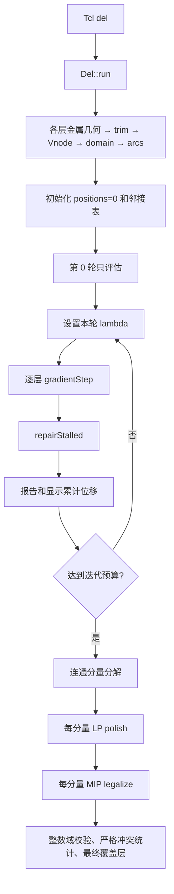

# DEL 当前运行流程、trim 更新量与 GPU 加速分析

分析日期：2026-10-13。对象是 `/workspace/openroad-26/src/del` 当前源码。
本次先完成阅读和方案分析，只新增本文与计时数据文件，没有删改算法或移植 CUDA。
时间数据来自工作区已有的无 GUI 运行，不是本次重新执行或 GPU 实测。

最重要的结论：连续迭代是适合 GPU 的稀疏图计算，但当前端到端耗时主要在后处理整数规划。
合理路线是“精简热路径 + GPU 连续优化 + CPU 分量求解 + 大分量 GPU 求解器实验”。
当前工具只输出 trim 覆盖层坐标与报告，不写回 OpenDB 实际布线。

## 1. 建议阅读顺序与完整调用链

以下路径均相对于 `src/del/`；行号对应本次阅读的当前文件。

| 阶段 | 入口与源码 | 作用 |
|---|---|---|
| Tcl 参数 | `src/del.tcl:25`，`src/del.i:44` | 解析参数，调用 `Del::run`，绑定显示回调 |
| 主流程 | `src/Del.cpp:44` | 清理上次状态，读取数据库，顺序构建 M2–M7 的图，进入优化 |
| 图构建 | `src/graph/BuildGraph.cpp:75` | 扫描金属，生成 trim，建立节点、移动域和约束边 |
| trim 几何 | `src/graph/TrimGeometry.cpp:110`、`:31` | 金属矩形并集，识别暴露端面，创建 W×2W trim |
| 节点 | `src/graph/Vnodes.cpp:30` | 每个 trim 一个节点，保留双倍中心坐标并排序分配 id |
| 移动域 | `src/graph/Domains.cpp:63` | 用 R-tree 查询障碍物，计算可移动边界 |
| 约束边 | `src/graph/Arcs.cpp:147`、`:45`、`:77` | 同轨 A/B、相邻轨 C；排除整个可达区间都合法的节点对 |
| 迭代调度 | `src/optimize/RunOptimization.cpp:158`、`:230` | 初始化各层优化器，按轮设置 lambda，顺序执行各层 step |
| 一轮数值更新 | `src/optimize/Optimizer.cpp:212` | 梯度下降 → 停滞修复 → 统计最终位移 |
| 停滞修复 | `src/optimize/StallRepair.cpp:112`、`:32` | 连续 3 轮可见位置不变且仍违规，尝试跨过势垒峰值 |
| 后处理调度 | `src/optimize/RunOptimization.cpp:282` | 输出连续阶段报告，然后逐层调用后处理 |
| 后处理算法 | `src/optimize/Postprocess.cpp:295`、`:85`、`:154` | 分连通分量，LP 缩小伸长量，MIP 整数合法化 |



`-step` 在第 0 轮返回，`n` 推进一轮，`c` 跑到预算结束。
普通模式直接循环。没有依据梯度或违规数量提前停止的判据，达到预算才进入后处理。
`-graph_only` 将预算设为 0：仍构图并评估第 0 轮，但不执行后处理。

### 1.1 优化变量究竟是什么

每个 trim 大小固定，中心只沿层的首选方向移动：水平层改变 X，垂直层改变 Y。
不是两个二维自由度，也不是每轮重新生成 trim 几何。

记该层线宽为 `W`，单位 DBU；节点原始沿轨中心为 `c_i=along2(node_i)/2`。
`along2` 保存双倍中心，避免半 DBU 中心丢失。

优化器的 `positions_[i]` 是**相对于原始中心的累计归一化位移**：

```text
x_i = accumulated_displacement_dbu / W
当前沿轨中心 = c_i + W*x_i
本轮更新量 = W*(x_i_new - x_i_old)
```

`displacementDbu()` 输出 `W*x_i`，不是本轮增量，也不是绝对中心。
GUI 每次从固定原始位置加 `llround(W*x_i)`，不会把累计位移再次累加。
对应 `Optimizer.cpp:237`、`OptimizationGraphics.cpp:94`。

### 1.2 固定域与固定图

图只在本次 `run()` 开始时构建，优化过程中不更新障碍物、域或边。
移动域由所有普通 `dbWire` 的该层金属产生，包括节点自己的网络、供电网络和 via 盒。
供电网络不生成 trim，但其普通 wire 金属会阻挡移动。
这里的障碍集合没有枚举 special wires、所有 pin shapes 或所有 placement blockages；解释结果时应按实际代码的几何模型理解。

`Domains.cpp:76`：trim 沿轨长度 W，横轨长度 2W。
R-tree 查询最大移动范围内金属，横向严格重叠才阻挡；边界接触不算重叠。
初始已重叠的 trim 标记 blocked，域固定在原点。
否则域最多向两侧各延伸 20W，再由最近金属边界收紧。

规则在 `include/del/Rules.h:15`：`D=5W`，`Dt=5W`，`Du=3W`。
约束距离是**沿轨中心的有符号差**，不是 trim 盒边缘间距，也不是二维欧氏距离。

| 类型 | 何时创建 | 合法沿轨距离，归一化后 |
|---|---|---|
| A | 同轨，非面对可合并端面 | `[5,+∞)` |
| B | 同轨，前一个 high_end、后一个 low_end | `{0} ∪ [5,+∞)` |
| C | 横轨距离大于 0 且不超过 pitch 的邻轨节点 | `(-∞,-3] ∪ {0} ∪ [3,+∞)` |

注意 C 的实际条件是 `0 < 横轨距离 <= pitch`，不是必须恰好等于 pitch。
已经合法的边仍然可能保留，因为之后移动可能产生违规；只有**整个可达距离区间**都合法才在构图时排除。
合法区间精确定义见 `Arcs.cpp:16`。

## 2. 每轮如何一步一步算出 trim 更新量

### 第一步：设置本轮约束权重

`RunOptimization.cpp:240`：第 0 轮只评估；第 1–25 轮 lambda=10，26–50 轮为 20，
51–75 轮为 40，第 76 轮起为 80。
各层独立调用 `step(lambda)`，没有跨层耦合。

初始化在 `Optimizer.cpp:45`：

```text
x_i = 0
L_i = (node.low2 - along2(node))/(2W)
U_i = (node.up2  - along2(node))/(2W)
blocked 节点：L_i=U_i=0
q_i = 1 + 节点的关联边条数
```

`q_i` 是度数加 1，不是单纯度数。邻接边编号和每条边停滞计数也在此建立。
这一初始化只发生一次。

### 第二步：算每条边的当前距离

对边 `e=(s,t)`：

```text
d_e^0 = (along2(node_t)-along2(node_s))/(2W)
d_e   = d_e^0 + x_t - x_s
```

源码：`Optimizer.cpp:203`，在 `evaluate()` 和修复中重复使用。

### 第三步：算规则势能及导数

源码：`Optimizer.cpp:15`、`:25`、`:32`。

下界罚函数：

```text
g = min(0, d-h)
LB(d,h) = g²
LB'(d,h) = 2g
```

区间势垒：当 `a<d<b`，令 `t=(d-a)/(b-a)`：

```text
Bump(d,a,b)  = 16*t²*(1-t)²
Bump'(d,a,b) = 32*t*(1-t)*(1-2t)/(b-a)
```

区间外以及端点处，两者均为 0。区间中点势能最高、导数为 0。

```text
A: phi(d) = LB(d, D/W)
B: d<0 时 phi(d)=LB(d,0)；否则 phi(d)=Bump(d,0,Dt/W)
C: d<0 时 phi(d)=Bump(d,-Du/W,0)；否则 phi(d)=Bump(d,0,Du/W)
```

B 的负距离罚函数防止节点穿越；C 允许负距离。
B/C 中点可能“仍违规但梯度为 0”，这正是 perturbation 和 barrier jump 存在的原因。
势能不是违规残差的平方的统一形式：B/C 使用非凸势垒，不能改成普通二次罚函数还声称算法相同。

### 第四步：汇总节点梯度

总能量，`Optimizer.cpp:89`：

```text
E(x) = 0.01 * Σ_i (sqrt(x_i²+0.01²)-0.01) + lambda * Σ_e phi_e(d_e)
```

前一项偏好少移动，后一项推动满足规则。
注意日志的 `extent_dbu=Σ|x_i|W` 与能量中的平滑伸长项不是同一个量。

先用伸长项初始化每节点梯度，再遍历所有边累加：

```text
g_i = 0.01*x_i/sqrt(x_i²+0.01²)
每条边 e=(s,t)：
  g_s -= lambda*phi'_e(d_e)
  g_t += lambda*phi'_e(d_e)
```

负号/正号来自 `d_e=d_e^0+x_t-x_s` 的链式求导。
一个 trim 的更新受**所有关联边**共同影响，不是独立按某一条冲突边推开。

同次 evaluate 还遍历每条边合法区间，算最近合法集合的残差：

```text
gap_e = min_over_ranges max(0, lower-d_e, d_e-upper)
```

不存在的上下界不参与比较。`gap>0` 就是严格违规；
`gap*W >= 5nm对应DBU` 才计入 remaining_violations。
5nm 阈值用于统计与触发修复，不会把小残差边从能量/梯度中移除。

### 第五步：按度数缩放，并投影到移动域

`Optimizer.cpp:150`：

```text
p_i = clamp(-g_i/q_i, L_i-x_i, U_i-x_i)
M   = max_i |p_i|
S   = M > max_step_w ? max_step_w/M : 1
```

`p_i` 是预处理后的方向。连接多的 trim 同样梯度下移动较少。
`S` 来自**整层最大方向分量**，不是每节点单独的学习率。

### 第六步：回溯试算候选坐标

`Optimizer.cpp:166`：最多 3 种尝试，每种最多 20 次回溯。
第 0 种使用正常梯度；第 1、2 种加确定性扰动，正负模式相反。

```text
j_i = 0                                      (attempt=0)
j_i = +0.01 if (i+attempt)%2==0 else -0.01    (attempt=1或2)
h   = S * 2^(-backtrack)
y_i = clamp(x_i + clamp(h*(p_i+j_i), -max_step_w, max_step_w), L_i, U_i)
```

先构建整层候选坐标，再重新评估整层能量。
若没有节点改变超过 `1e-12`，退出当前 attempt 的回溯循环。
若某个候选满足：

```text
E(y) < E(x) - 1e-12*max(1,E(x))
```

立即接受第一个满足条件的候选，交换 positions 与 candidate，然后退出。
这不是固定步长更新，也不是带 Armijo 斜率条件的线搜索。
最多可有 60 次候选能量评估，加上最开始的一次带梯度评估。
如果正常梯度没有接受结果且原规则能量为 0，不再做扰动。
所有候选失败时，梯度阶段保持旧位置。

### 一个可手算的正常梯度例子

取 `W=10 DBU`，单条 A 边，初始中心距离 `40 DBU`，两端累计位移均为 0，
移动域足够宽、`q_s=q_t=2`、`lambda=10`、`max_step_w=0.25`。

```text
d=4，h=5，phi=1，phi'=-2
g_s=+20，g_t=-20
p_s=-10，p_t=+10
M=10，S=0.25/10=0.025
第一个候选：y_s=-0.25，y_t=+0.25
新距离：4+0.25-(-0.25)=4.5
旧能量：10
新能量：10*(4.5-5)² + 2*0.01*(sqrt(0.25²+0.01²)-0.01)
       ≈2.504804 < 10
接受。本轮 src 更新 -2.5 DBU，dst 更新 +2.5 DBU。
```

如果候选总能量没有下降，需要减半步长继续试算；不能只看这一条边势能下降就接受。

### 第七步：检查停滞并执行跨势垒跳跃

`step()` 并未在梯度下降后结束，见 `Optimizer.cpp:212`。
`StallRepair.cpp:112` 先对**每条边**计数：

```text
round(W*x_src_new)==round(W*x_src_old)
round(W*x_dst_new)==round(W*x_dst_old)
并且更新前、更新后该边残差都 >=5nm 且为正
→ 该边 stalled_rounds 增 1，上限 3
否则清零
```

源码使用 `llround`，比较的是累计位移的整数显示结果。
不是“浮点步长小于 1 DBU”，小步也可能跨过取整边界并重置计数。

计数达到 3 后，按固定边顺序执行 `jumpAcrossBarrier()`：

1. B 仅在 `0<d<Dt/W` 中跳，峰值 `m=Dt/(2W)`。
   C 仅在 `0<|d|<Du/W` 中跳，峰值 `m=sign(d)*Du/(2W)`。
   A 和负距离 B 没有峰值，不能用此方法修复。
2. 将 nm 跳跃偏移归一化：`eta=jump_offset_nm*dbu_per_micron/(1000W)`。
3. 如果 `d<=m`，目标为 `m+eta`；否则为 `m-eta`。
   恰在峰值时，先试增大距离，不能实现再试另一侧。
4. `change=target-d`，`sigma=sign(change)`，`T=|change|`。
5. 两端反向移动：`x_s'=x_s-sigma*a`，`x_t'=x_t+sigma*(T-a)`。
   根据域求 src/dst 可移动容量 `Cs,Ct`。
6. src 的可行分配区间：`a_min=max(0,T-Ct)`，`a_max=min(T,Cs)`。
   两端合计容量不足则失败，只有 ULP 级误差才允许容忍。
7. 按度数分配：`a_preferred=T*q_t/(q_s+q_t)`，
   再 clamp 到 `[a_min,a_max]`。连接越多的一端移动越少。
8. 重算目标距离，检查有限值、真正跨过峰值、目标误差；全部通过才同时提交两端。
9. 对实际移动端点的所有关联边清零停滞计数，防止该移动端点本轮再参与跳跃。

核心源码：`StallRepair.cpp:32`，容量和分配在 `:55`、`:77`，提交在 `:104`。

**跳跃不检查能量下降，也不受 `max_step_w` 限制。**
所以完整一轮可能能量增加，也可能最大位移超过配置的梯度步长上限。
`stall_repaired` 实际记录成功跳跃数，不代表边已经严格合法；后续迭代继续下降。

### 第八步：得到最终更新量与输出

本轮最终位置包含梯度更新以及可能的跳跃：

```text
delta_trim_i_dbu = W*(positions_i_after_repair - positions_i_before_step)
```

若发生跳跃，重新评估能量与违规数；最后用本轮开始的旧坐标重算 moved 和 max_step。
源码：`Optimizer.cpp:217`、`:227`。
`RunOptimization.cpp:246` 顺序执行各层，保存累计 DBU 位移、写 CSV、flush、记录日志、调用显示回调。

## 3. 后处理如何处理

### 3.1 分量与并发调度

`postprocessLayer()` 用全部约束边构建并查集，把节点和边分为连通分量。
没有边的独立节点直接回到 0 位移，不进入求解器。
有边的分量依次做 LP 和 MIP。

每层最多 4 个 worker，用原子计数器领取分量任务；不同分量写不同节点。
层外虽使用 `std::async`，但调用方等待当前层完成后才启动下一层，**六层仍然串行**。
`OpenROAD threads=16` 不会把这里硬编码的 4 个 worker 自动改成 16。
源码：`Postprocess.cpp:306`、`:348`、`:398`，`RunOptimization.cpp:308`。

### 3.2 LP polish：降低伸长量，不增加各边残差

`Postprocess.cpp:85`，变量改回 DBU：`u_i` 是累计位移，域为 `[lo_i,hi_i]`。
blocked 节点固定 0。优先 HiGHS LP，缺失时 GLOP；每分量限制 1 秒、求解器 1 线程。

对每条边，先求连续阶段距离 `d=c_t-c_s+before_t-before_s`。
枚举合法区间 `[l,u]`，取残差最小的区间，平局保留枚举中第一个。
令最小残差为 `gap`，建立扩大后的差分约束：

```text
min(l-gap,d)-(c_t-c_s) <= u_t-u_s <= max(u+gap,d)-(c_t-c_s)
```

这让当前解可行，且允许沿所选分支缩小残差；LP 不枚举切换到其他离散分支。

目标实际是线性形式：

```text
min Σ_i sign_i*u_i
sign_i = +1 if high_end else -1
```

源码没有给每节点额外建立绝对值变量。
在正常外置端面被自身金属约束的单侧域中，它对应伸长量；若复用到双侧自由域，需要重新审视这一目标是否仍等价于 `Σ|u_i|`。

只有返回 OPTIMAL 才采用解，然后独立检查：
域内（容差 `1e-6 DBU`）、实际总绝对位移没有增加、每条原始边残差没有增加。
不满足就把该分量恢复到连续解；因此 `polish_optimal` 同时反映求解/校验是否成功。

### 3.3 MIP legalize：重新选分支，求整数位移

`Postprocess.cpp:154`，优先 HiGHS MIP，缺失时 SCIP；每次求解限制 5 秒、1 线程。

模型变量：

| 变量 | 含义 |
|---|---|
| `u_i` | 整数 DBU 累计位移，域 `[ceil(lo_i),floor(hi_i)]` |
| `v_e∈{0,1}` | 允许此边有冲突的开关 |
| `t_e∈Z, t_e>=0` | 此边的松弛/残差，单位是双倍 DBU |
| `b_er∈{0,1}` | 选择哪一个合法区间，`Σ_r b_er=1` |

边实际双倍距离为 `z_e=initial2+2(u_t-u_s)`。
`cap` 和 big-M 根据两端域推导，不是随意给很大的常数。
约束可以写为：

```text
t_e <= cap_e*v_e
z_e+t_e >= lower_er - Mlow_er*(1-b_er)     有下界时
z_e-t_e <= upper_er + Mhigh_er*(1-b_er)     有上界时
```

当区间被选中，限制距该区间的偏离；未选中时通过域导出的 big-M 放松。
B/C 的区间选择是离散决策，MIP 可以重新选择合并或分离，LP 的选择不约束它。

求解顺序：

1. 先固定所有 `v_e=0`，直接求“零冲突 + 最小线性伸长量”。
   返回 OPTIMAL 或 FEASIBLE 就取整数解；FEASIBLE 记为未证最优。
2. 只有明确返回 INFEASIBLE 才解锁 `v_e`；超时无解不会被当成不可行证明。
3. 最小化 `Σv_e`，固定获得的目标值。
4. 最小化 `Σt_e`，固定获得的目标值。
5. 最小化线性伸长量。

这是分阶段的优先级目标：冲突条数 → 总残差 → 伸长量。
若某阶段只取得 FEASIBLE，固定的是当前可行目标值，**不能声称全局词典序最优**。
最坏一个分量会触发 4 次 MIP 求解，名义上可达 20 秒，另加 LP 和建模/序列化开销。
时限约束求解器求解阶段，不是整个分量的端到端硬时限。

当前代码没有 `SetHint` 等初始解注入。传给 `legalize()` 的 polished 坐标用于初始化/失败保底，
却不参与 MIP 变量、约束、目标的构建。
因此在求解均达到最优的情形下，连续解和 LP polish 不是 MIP 最优目标所必需的输入。
超时或失败时它们仍影响保底输出；多重最优解的具体坐标也不必完全一致。

### 3.4 取整、失败和最终冲突判定

polished 结果先 round 到整数并 clamp 到整数域，再交给 MIP 覆盖。
无可用解时保留最近一次已捕获解，或初始化的取整结果，增加 nonoptimal 计数。
最后独立确认每个最终位移有限、整数、严格在原始域内。

整数的是**位移**，原始中心仍可能处于半 DBU，所以合法化后中心仍可能是半 DBU。
源码和测试允许 0.5 DBU 残差：`test/PostprocessTest.cpp:95`。

最后通过原始合法区间重新计算 `trimResidualDbu()`，任何正残差都计为严格冲突。
后处理不会把小于 5nm 的残差当成完全合法；只单独标记 below_5nm。
`nonoptimal_components=0` 也不代表零冲突，因为约束可能本来无零冲突解。

最终仅更新 `displacements_`、显示覆盖层，输出 `*_postprocess.csv`、
`*_postprocess_displacements.csv`、`*_conflicts.csv`，没有调用布线写回。
这是 DEL 图模型的冲突统计，不是执行真实路由 DRC 得到的结果。

## 4. 时间开销：源码复杂度与已有实测

### 4.1 无 GUI 数据

证据：`/workspace/openroad-26/delRun/headless-RY5bMhIR/run.log`，
对应 CSV 和 `time.txt`；参数 200 轮、0.25W、35nm、frame_ms=0。
全图 N=328,756，E=431,308，6 层，85,069 个连通分量（包含孤立点）。

| 阶段 | 墙钟时间 | 占 DEL 内部总时间 |
|---|---:|---:|
| 建图 | 2.017s | 0.86% |
| 第 0 轮和 200 轮连续阶段，含该阶段报告/回调 | 40.173s | 17.13% |
| 后处理各层等待至完成时间之和 | 188.594s | 80.43% |
| 剩余未单独归属的时间 | 3.705s | 1.58% |
| DEL 内部总时间 | 234.489s | 100% |

进程墙钟 234.93s；Tcl 对 DEL 的计时 234.504s，和内部计时边界略有区别。
未归属时间包括连续残差导出、初始化、最终 CSV 等，现有日志不足以进一步拆分。
不能把 40.173s 直接解释成纯梯度内核耗时。

| 层 | 后处理墙钟 | LP worker 累积时间 | MIP worker 累积时间 | 分量数 |
|---|---:|---:|---:|---:|
| M2 | 107.663s | 8.827s | 421.166s | 21,297 |
| M3 | 54.470s | 8.412s | 209.132s | 34,808 |
| M4 | 12.797s | 2.242s | 48.768s | 13,343 |
| M5 | 5.590s | 1.177s | 20.979s | 7,341 |
| M6 | 6.461s | 0.866s | 24.905s | 4,715 |
| M7 | 1.613s | 0.271s | 6.152s | 3,565 |

worker 累积时间是并发工作段的时间求和，不能与墙钟直接相加。
MIP 工作段包含建模、导出模型、求解、读解等，不只是分支定界。
合计 LP 21.795 worker-s，MIP 731.102 worker-s：后处理绝大多数工作在 legalize。
M2、M3 占后处理墙钟约 86%；仍需分量级 profile 判断是大量小模型开销还是少数大模型尾部延迟。

最后严格冲突 45 条：M2=37，M6=8；28 条小于 5nm，17 条不小于 5nm。
M2 两个分量未证明最优。该数据不是“全部修复”的结果。

另一组 0.2W/5nm 无 GUI运行：连续阶段 35.827s，后处理 186.701s，DEL 约 228.318s；
结论同样是后处理占主导。

GUI 日志存在用户单步、事件处理和显示等待；例如 M2 墙钟 1484.498s 与 worker 时间明显不一致。
它不能替代无 GUI 性能基线，也不能从差值直接判断具体等待原因。

### 4.2 计算复杂度

记每层 N 个节点、E 条边、R 为每轮实际候选评估次数（上限 60）：

| 部分 | 时间开销 | 说明 |
|---|---|---|
| 单次 evaluate | O(N+E) | 每条边最多 3 个合法区间，视为常数 |
| 正常 gradientStep | O((1+R)(N+E)) | 每次回溯都扫描全部节点和边 |
| 停滞计数 | O(E) | 前/后违规检查及取整判定 |
| 停滞跳跃提交 | 边扫描与邻接重置开销 | 顺序依赖，不能直接每边并发写端点 |
| 连续总阶段 | O(Σ_round Σ_layer (1+R_l)(N_l+E_l)) | 源码没有 layer 级并行 |
| 后处理分量构建 | 并查集和分组，近线性 | 当前按 N 大小分配多个嵌套 vector |
| LP/MIP 求解 | 随分量规模及离散分支变化 | MIP 无法保证 O(N+E)，难例可能占主导 |

构图也不能仅按输出边数估算：节点排序 O(N log N)，边排序 O(E log E)。
R-tree 域查询受障碍命中数影响。邻轨建边虽然有距离过滤，仍顺序扫描同轨/下一轨节点；
特别是同轨 `continue` 和邻轨沿轨距离过滤，并未保证访问候选对数等于 E，最坏仍可出现二次扫描。
这一数据集构图仅约 2s，暂时不是优先 GPU 化对象。

连续热路径的明显额外工作：

- `evaluate(candidate,...,nullptr)` 不止算能量，还计算全部违规、残差和 extent；这些统计不参与候选接受判定。
- 每轮分配 gradient、direction、candidate，复制 previous 和累计位移。
- 每轮各层调用 `displacementDbu()`，复制整图坐标，写 CSV 并 flush，输出日志。
- `arcDistance()` 每次读取节点和方向再计算原始距离；阈值每边重复换算。
- 停滞检测每边重复对共享节点 llround，可先按节点计算 visibly_moved 标志。
- 后处理先创建 MPSolver 模型，再导出 proto，经 SolveMPModel 建后端模型；存在值得测量的模型转换开销。

### 4.3 GPU 只加速连续阶段的收益上限

按现有 234.489s 总耗时，仅连续阶段加速 S 倍：

```text
T_new ≈ 234.489 - 40.173 + 40.173/S
```

S=10 时约 198.333s，即端到端 1.182 倍；S→∞ 时上限约 1.207 倍。
这还是乐观估计，因为把整个连续阶段的报告开销也算成可被 GPU 加速。
如果只关心连续求解、批量参数搜索，GPU 价值更大；若关心完整 DEL，应同时优化后处理。

## 5. 哪些代码适合精简，哪些必须保留

建议提供 fast/headless 路径，把诊断从数值内核剥离，保留原始参考路径用于对照。
无需破坏已有 GUI 功能或直接删除源文件。

| 内容 | 合理处理 | 对结果的影响 |
|---|---|---|
| GUI renderer、暂停、逐帧坐标回传 | 快速路径关闭，或每 K 轮刷新 | 不影响数值算法；失去实时可视化 |
| 每轮日志/CSV/flush | 降频或仅最终输出 | 不影响 solver，改变观测粒度 |
| 候选的完整统计 | 拆成 energyOnly 与 accepted-state stats | 保持接受条件，减少区间判断 |
| 临时向量分配 | workspace 复用与双缓冲 | 保持算法 |
| 原始中心差、阈值、域 | 构图后预计算 | 保持模型；浮点运算顺序需对照 |
| blocked 节点 | 紧凑化移动变量，保留固定节点作为边端点 | 不能丢掉固定节点施加的约束 |
| 两端全固定的边 | 可聚合常量能量和常量冲突 | 保持常量和接受阈值语义，不能简单删掉 |
| 初始已经合法的边 | 保留所有可能被移动破坏的边 | 直接删除会漏约束 |
| B/C 势垒、jitter、回溯、停滞计数 | 首版保持 | 删除会改变逃离局部停滞及收敛行为 |
| 整数校验、严格残差、MIP 状态判断 | 保留 | 防止取整后非法或误报修复 |
| LP polish | 可以做独立 A/B 实验 | MIP 最优目标不依赖它，但失败保底与报告会变化 |

对孤立节点，可设计固定在零的精简策略；若要求完全复现当前扰动轨迹，必须注意原代码 jitter 也会写入孤立节点。
节点重编号也必须保留原 id，用它生成 jitter，否则确定性扰动模式改变。

## 6. 合理的 GPU 方案

### 6.1 首版范围与数据格式

优先移植 `evaluate`、`gradientStep`、停滞标志计算、最终残差计算。
OpenDB、Boost 几何并集和 R-tree 构图保留 CPU；CPU 侧继续使用整数求解器。
本机可见 NVIDIA A800 80GB PCIe；`nvcc` 不在当前 PATH，本次未安装工具链或占用 GPU 做性能实验。
`nvidia-smi` 的 CUDA Version 是驱动支持能力，不等于 CUDA 编译工具链已安装。

不要把带 string、vector、odb::Rect 的 `LayerNodes/Arc/Vnode` 原样传 GPU。
准备平坦的结构分离数组（SoA）：

```text
node: x[], low[], up[], degree[], original_id[], layer_id[], origin2[]
edge: src[], dst[], type[], initial_distance[], threshold[], stalled_rounds[]
CSR:  row_ptr[N+1], incident_edge_id[2E], incident_sign[2E]
state: previous[], gradient[], direction[], candidate[], visibly_moved[]
layer: node/edge offsets, W[], per-layer scale/energy/accept flags
```

几何原点和整数残差保留 int64；连续坐标、梯度、能量首版用 FP64。
N/E 规模的数据主要是几十到一百多 MB 量级，取决于缓冲和模型展开，远小于 80GB；
正式实现需按实际字段逐项计算内存，而不分配 N×N 稠密邻接矩阵。
先用一张 GPU，避免在这个规模引入多卡通信。

每层都独立求最大方向、能量和接受条件。若把六层拼起来处理，必须用分层归约；
**全图只取一个最大步长或全图统一接受，会改变当前算法。**

### 6.2 内核安排

| 内核 | 并行方式 | 工作 |
|---|---|---|
| edgePotential | 一线程一条边 | 读取两端坐标，计算 phi 和 phi' |
| nodeGradient | 一线程或一 warp 一个节点 | 加正则梯度，按 CSR 顺序 gather 关联边导数 |
| direction | 一线程一节点 | 除 degree、clamp 域、输出 abs(direction) |
| layerReduceMax | 分层归约 | 得到各层 M 与 S |
| candidate | 一线程一节点 | 按原 id 加 jitter、回溯比例、两次 clamp |
| candidateEnergy | 边/节点并行加分层归约 | 仅计算候选能量 |
| accept | 每层一个状态 | 检查原接受条件、选择第一次成功候选 |
| acceptedStats | 节点/边并行 | 对接受状态计算统计，避免所有失败候选都做统计 |
| stalledFlags | 一线程一节点，然后一线程一边 | 同样的 llround 与前后违规规则 |

回溯是自适应且各层可能次数不同：首版可由 CPU 控制，只回传几个能量/accept 标量。
坐标和图常驻显存，不能每个 trial 回传整图。
后续再用捕获的内核序列、设备侧状态降低 launch 和同步开销；先测量瓶颈再增加调度复杂度。

梯度累加有两个选择：

1. 每边向两端 `atomicAdd(double)`，容易实现，但累加次序不固定且高连接节点可能争用。
2. 每边先写导数，再按节点 CSR gather，免原子竞争，可以按原边编号组织求和。

建议首版用 CSR gather。CUDA 原生 FP64 atomicAdd 从 compute capability 6.0 起支持，
但有原子支持并不意味着应选择原子方案。来源：[NVIDIA CUDA Programming Guide](https://docs.nvidia.com/cuda/archive/13.0.0/cuda-c-programming-guide/index.html#atomicadd)。
这类稀疏、分段势函数与归约计算适合普通 CUDA 内核，无需强行转成稠密矩阵乘法或 Tensor Core 计算。

### 6.3 停滞跳跃的并发问题

不能把 `jumpAcrossBarrier` 直接变为“每边一个线程并行写两端”。
共享节点会冲突，而且 CPU 代码的相邻边计数清零、边处理顺序影响后续跳跃资格。
全局坐标即使用原子加也不能保持这套联合容量和提交语义。

保守方案：GPU 并行计数，压缩达到 3 轮的边；CPU 按原始顺序处理候选边。
传输候选端点、域、度数及必要邻接计数，维护同样的重置规则，再写回改变的数据。
如果候选很多，稀疏传输也可能昂贵，需要测量。

进一步的方案：图连通分量之间本来无共享节点，可以每分量顺序处理、分量之间并行。
若同一分量内改成边着色或独立边集并行跳跃，会改变原始边序，应作为新算法验证，不能称为严格等价移植。
先保留顺序跳跃可避免将优化正确性与并行策略同时改变。

### 6.4 后处理的优先优化

后处理是约 80% 的墙钟开销，应优先做以下工作：

1. 加分量级 profile：节点数、边数、二进制变量数、建模/proto/求解时间、每阶段状态、目标界与 gap。
   统计 p50/p95/max，并区分孤立点、微小分量、大分量。
2. 建立所有层共用的分量任务队列，在允许的 CPU 资源内动态调度。
   当前机器报告 128 个逻辑 CPU，但实际容器配额、内存和 solver 并发能力仍需核实；
   不应把 worker 数直接设成 128。
3. 对小分量考虑可证明正确的专用解法；例如 A-only 或固定合法分支是差分约束，
   可研究网络结构的 LP/整数优化。半 DBU/parity 及不可行分支必须单独处理。
   任意 B/C 分支选择不能被普通逐边推开替代。
4. 使用更直接的稀疏模型接口降低重复建模/序列化，评估后端是否支持 warm start/hint，
   将已有可行整数解用作初始解。当前仅保留坐标作失败保底，没有利用它帮助搜索。
5. 大分量再评估 GPU LP/MIP，微小分量继续 CPU。LP worker 累积仅占后处理工作约 2.9%，
   仅把 LP 搬 GPU 对端到端收益有限。

对需放松的分量可先在原始整数域上做端点固定、不可达分支删除、域传播等 presolve。
所有删边或删分支必须有域可达性证明，不能仅因为当前点合法就删除。

### 6.5 GPU 整数规划求解器是否可用

NVIDIA cuOpt 官方文档提供 LP 和 MIP 能力。当前 MIP 标为 beta：
GPU 加速 primal heuristics，CPU 的分支定界等算法负责改进界；可行解质量和最优性证明是不同能力。
因此“全部整数后处理都变成 GPU kernel”不是直接替换方案。
来源：[NVIDIA cuOpt Introduction](https://docs.nvidia.com/cuopt/user-guide/latest/introduction.html)。

如果引入 cuOpt，推荐实现独立后处理 backend，保留 HiGHS 参考实现。
复用相同的整数位移、big-M、区间选择及分阶段目标；每次固定前一阶段目标值时保持同样的状态规则。
用原始 int64 双倍距离做独立校验，记录可行性、冲突数、总残差、伸长量、optimal 状态。
仅有更快可行解不等于已有最优性语义得到满足。

对于许多小模型，逐分量调用 GPU solver 的启动和模型传输可能抵消收益；
把所有分量合成一个巨大 MIP 又可能改变时限、分量最优状态和搜索行为。
合理做法是先量出分量规模分布，按规模选择 backend，并对有限批量合并做实验。
这属于基于源码结构的方案推断，目前没有此 DEL 模型上的 GPU 求解实测。

## 7. 实施顺序与验收条件

建议按下面顺序改造，每一步单独比较结果和时间：

1. 固定无 GUI 基线，补齐分量 profile 与每轮回溯次数。隔离算法计时和报告 I/O。
2. CPU 先拆 energyOnly，复用 workspace，预计算常量，降低输出频率。
3. 建 GPU SoA/CSR、FP64 势函数与梯度，先对一个正常更新轮逐项对照，再跑完整预算。
4. GPU 化回溯和停滞计数，保留顺序跳跃；只在显示和阶段结束时回传整图。
5. 后处理建立全层任务队列、微小分量专用解法与 hint/backend 实验。
6. 用代表性大分量评估 cuOpt；有收益再扩展，不先替换全部后处理。

GPU 首版需保持：每层 scale/接受条件、度数加 1、原 id jitter、LLROUND 半值规则、
3 轮边停滞计数、跳跃不受 max_step 限制、5nm 触发语义、后处理严格整数域与残差校验。
并行归约和 FMA 可能造成浮点差异；即使 FP64 也不保证逐位相同，尤其可能影响非常接近阈值的回溯选择。

验收要同时看：完整 DEL 墙钟、连续阶段时间、后处理时间、严格冲突与 >=5nm 冲突、
总残差、总伸长量、nonoptimal 分量，以及原始 ODB 是否保持当前行为。
不能只拿 kernel 时间或“冲突少于 5nm”作为成功标准。

用于验收的现有针对性测试包括 `test/OptimizerTest.cpp`、`test/DomainTest.cpp`、
`test/ArcTest.cpp`、`test/PostprocessTest.cpp`；本次仅作静态阅读，未运行这些测试。
对应计时汇总已保存到同目录 `runtime_analysis_metrics.json`，便于复算占比和 Amdahl 上限。
