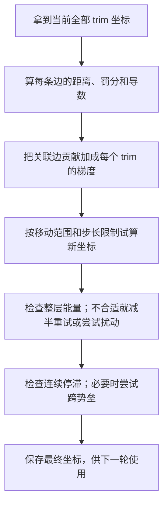

# DEL 的 trim 到底怎样更新：从两个点讲起

这份文档只围绕一个问题：**已知现在 trim 在哪里，程序怎样算出下一轮它应该在哪里？**

你说的“计算距离，计算梯度，然后更新”就是核心。
更准确地说：**程序根据距离算梯度，再移动两个 trim 的坐标；坐标变了，距离自然就变了。**

这里先不写复杂的总更新函数，也不要求先理解所有源码变量。我们跟着两个 trim，完整走一轮。

## 1. 先把 trim 看成一个点

trim 本来是一个小矩形，但迭代只平移它，不改变尺寸。因此先用矩形中心表示它的位置。

假设在水平布线层，有两个 trim，叫 A、B：

| trim | 现在的中心坐标，单位 DBU |
|---|---|
| A | (100, 200) |
| B | (140, 200) |

DBU 是数据库里的长度单位。此处先把它理解成坐标使用的长度单位即可。

A 在左边，B 在右边。它们之间沿水平方向的距离是 40。

水平层只允许左右移动，所以这一轮只需要更新 X，Y=200 始终不变。垂直层同理，只更新 Y。

本文 A、B 是两个 trim 的名字。后面提到“B 类规则”时，那个 B 是约束类型，含义不同。

## 2. 第一步：算两个 trim 当前的距离

假设这一层线宽是 10 DBU。程序为了让不同层使用相近的数值尺度，把距离除以线宽：

$$
d=\frac{x_B-x_A}{W}=\frac{140-100}{10}=4.
$$

这里每个符号的意思是：

- $x_A$：trim A 当前的 X 坐标，等于 100。
- $x_B$：trim B 当前的 X 坐标，等于 140。
- $W$：这一层线宽，等于 10 DBU。
- $d$：程序内部使用的距离，等于真实沿轨距离除以线宽。这里 4 表示两个中心相距 **4 个线宽**。

所以，“距离是 40 DBU”和“程序中的 d 是 4”描述的是同一件事，没有多计算一份几何。

此处距离是沿轨的中心差，不是矩形边缘间距。本例用 B 的坐标减 A 的坐标；源码统一用约束边的 dst 坐标减 src 坐标，不额外取绝对值。

原代码：[Optimizer.cpp:203](/workspace/openroad-26/src/del/src/optimize/Optimizer.cpp:203)。

## 3. 第二步：看这个距离好不好，给它一个罚分

现在给这两个 trim 一条简单规则：**中心距离至少要有 5 个线宽，也就是 50 DBU。**

现在只有 4 个线宽，不够。因此程序给这条约束一个罚分。对于这种必须保持间隔的规则，违规时使用：

$$
\phi(d)=(5-d)^2.
$$

- $d$：刚算出的当前距离，以线宽为单位。
- 5：这条规则要求的最小距离，以线宽为单位。
- $\phi(d)$：这个距离产生的罚分，也叫势能。
- 平方：让“差得很多”比“只差一点”罚得更重。

这条式子用于 d<5 的违规情况。距离已经达到 5 或更大时，这一项罚分为零。

看看几个数就能理解：

| 当前距离 d | 还差几个线宽 | 罚分 |
|---:|---:|---:|
| 4 | 1 | 1 |
| 4.5 | 0.5 | 0.25 |
| 4.9 | 0.1 | 0.01 |
| 5 或更大 | 0 | 0 |

**优化就是尝试移动 trim，让整层的总罚分降低。**

原代码：[Optimizer.cpp:25](/workspace/openroad-26/src/del/src/optimize/Optimizer.cpp:25)。

## 4. 第三步：梯度告诉我们，往哪边动会更好

先不把梯度理解成难懂的数学对象。它回答的是：

> 如果我把某个量稍微增大一点，罚分是增加还是减少？变化有多快？

对上面的距离罚分求导：

$$
\phi'(d)=2(d-5),\qquad \phi'(4)=-2.
$$

- $\phi'$：罚分对距离的导数。撇号表示求导。
- $d$：当前归一化距离。
- 5：最小距离阈值。
- -2：当前位置的斜率为负，表示**增大距离能够降低罚分**。
- 常数 2：来自平方函数的求导。

现在问题来了：怎样增大 A、B 之间的距离？

- A 向左移动，距离增大。
- B 向右移动，距离也增大。

因此，“距离的梯度”要分别转换为“两个 trim 的梯度”。

程序还会给规则罚分乘一个权重。本例在第一轮，权重为 10：未加权的距离导数是 -2，加权后是 -20。

| 对象 | 加权梯度 | 取负梯度后的移动方向 |
|---|---:|---|
| trim A | +20 | 向左 |
| trim B | -20 | 向右 |

为什么两个梯度符号相反？因为距离是 **B 的坐标减 A 的坐标**：

增大 A 的坐标会缩短距离，增大 B 的坐标会拉长距离。

这里的梯度是对“以线宽为单位的移动量”计算的，不能把 +20、-20 直接当成 DBU 坐标增量。

原代码：[Optimizer.cpp:115](/workspace/openroad-26/src/del/src/optimize/Optimizer.cpp:115)。

## 5. 第四步：知道方向以后，还要决定这一轮移动多少

如果直接按梯度移动，可能一下移动过头，也可能撞进不允许进入的金属区域。
所以程序会给梯度加几个实际限制。

仍然用这两个 trim。为了把实际代码完整算一遍，再规定：

- A 最多能向左走 20 DBU，不能向右走。
- B 最多能向右走 20 DBU，不能向左走。
- 这一轮梯度移动上限为 0.25 个线宽，即 2.5 DBU。

程序按以下顺序处理：

| 步骤 | A 的下降方向 | B 的下降方向 | 为什么这样做 |
|---|---:|---:|---|
| 取负梯度 | -20 | +20 | 向罚分降低的方向走 |
| 除以“关联边数量加 1” | -10 | +10 | 连接多的节点不要走得太激进；本例每个节点只有一条边，所以除以 2 |
| 限制到允许移动范围 | -2 | +2 | 最大只允许移动 20 DBU，也就是 2 个线宽 |
| 再按整层最大方向缩小 | -0.25 | +0.25 | 最大方向是 2，上限是 0.25，因此全部乘以 0.25/2=0.125 |
| 转回真实长度 | -2.5 DBU | +2.5 DBU | 最后乘线宽 10 DBU |

表里的前三行仍然是“以线宽为单位”的内部数值，最后一行才是实际坐标要改变多少。

整层缩小的意思是：这一层所有 trim 的方向一起乘同一个比例，限制最快的那个 trim；不是给每条边单独定一个步长。

原代码：[Optimizer.cpp:156](/workspace/openroad-26/src/del/src/optimize/Optimizer.cpp:156)。

## 6. 第五步：先试算新位置，确认变好了才接受

现在已经算出候选移动量：A 左移 2.5，B 右移 2.5。

$$
\begin{aligned}
x_A^{\mathrm{new}}&=x_A^{\mathrm{old}}+\Delta x_A=100-2.5=97.5,\\
x_B^{\mathrm{new}}&=x_B^{\mathrm{old}}+\Delta x_B=140+2.5=142.5.
\end{aligned}
$$

- $x_A^{\mathrm{old}},x_B^{\mathrm{old}}$：本轮开始时的旧 X 坐标，也就是上一轮留下的坐标。
- $x_A^{\mathrm{new}},x_B^{\mathrm{new}}$：试算得到的新 X 坐标，通过检查后才作为本轮输出、下一轮输入。
- $\Delta x_A,\Delta x_B$：**本轮增量**，分别为 -2.5、+2.5 DBU。符号 Δ 表示变化量。
- 上标 old、new 是旧值和新值的标签，不是乘方。

Y 不变，所以新中心是：A=(97.5,200)，B=(142.5,200)。

更新后的中心距离是 45 DBU，也就是 4.5 个线宽。规则罚分从 1 降到 0.25。

乘上本轮规则权重 10 后，规则能量从 10 降到 2.5。代码还有一项偏好少移动的微小正则罚分，本例新总能量约为 2.5048，仍然明显低于旧总能量 10。

于是接受这个新位置。

### 如果试算结果反而更差呢？

程序就把本次步长减半，再试一次。还不行，再减半。

每次都从本轮旧坐标重新试算，不会把失败候选当作下一次的出发点。

这叫“回溯”。意思就是：**方向有了，但先试着走；走太远不好，就少走一点。**

正式代码要求整层总能量有足够的下降，不能只比较这一条边，也不能把浮点误差级的下降当作进步。

原代码：[Optimizer.cpp:166](/workspace/openroad-26/src/del/src/optimize/Optimizer.cpp:166)。

## 7. 接受后，一轮就完成了吗？下一轮从哪里开始？

还会检查一次有没有停滞需要修复；如果没有触发，就完成这一轮。

这次例子没有停滞跳跃，因此一轮结束后：

| 状态 | A 的中心 | B 的中心 | 中心距离 |
|---|---|---|---:|
| 本轮输入 | (100,200) | (140,200) | 40 DBU |
| 本轮输出，也是下一轮输入 | (97.5,200) | (142.5,200) | 45 DBU |

下一轮使用 97.5、142.5 重新计算距离和梯度。此时距离是 4.5，未加权的距离导数为 -1，已经比上一轮的 -2 小了。

**每一轮都会重算梯度，不能把这一轮的 -2.5/+2.5 当成固定增量反复使用。**

同时，初始坐标 100、140 仍然保存着。程序需要知道一个 trim 相对于初始位置已经累计移动了多少，来计算“尽量少移动”的正则项。

因此要分清：

- 当前坐标：这一轮从哪里开始。
- 本轮增量：这一轮准备移动多少。
- 初始坐标：本次运行开始时在哪里。
- 累计位移：当前坐标减初始坐标。

源码中的 `positions_` 保存的是“累计位移除以线宽”。它不直接保存 XY 绝对中心，也不只保存本轮增量。

原代码：[Optimizer.cpp:68](/workspace/openroad-26/src/del/src/optimize/Optimizer.cpp:68)、[Optimizer.cpp:237](/workspace/openroad-26/src/del/src/optimize/Optimizer.cpp:237)。

## 8. 为什么不能直接把每条距离改到合法值？

因为一个 trim 通常和多个邻居都有约束。

例如，同一条线上依次有三个 trim：P、Q、R。P—Q 太近，Q—R 也太近。

- 要拉开 P—Q，第一条边希望 Q 向右。
- 要拉开 Q—R，第二条边希望 Q 向左。

两条边都在给 Q 提建议。如果直接修改两条距离，两条建议可能要求 Q 同时往不同方向移动。

程序的做法是：**把所有关联边给 Q 的梯度加起来，得到 Q 唯一的移动方向。**

如果两条建议强度恰好一样，它们会抵消，Q 本轮可能不动，P 和 R 则可以向外移动。

所以真正可操作的变量是 trim 坐标。距离是由这些坐标算出的，不能把各条距离看成互不相关的自由变量。

整层也不是处理一条边就立刻移动两端。正常梯度阶段先使用同一份旧坐标算完所有边、汇总所有节点梯度，再统一试算新坐标。

这就是原代码比“一个距离做梯度下降”多出的第一个必要部分。

## 9. 另外两类规则为什么会卡住？

前面的例子是最简单的规则：距离不够就拉大。

但 DEL 还有允许合并的规则。比如 B 类规则允许两种结果：

- 两个中心恰好对齐，距离为 0。
- 两个中心足够远，距离至少为 5 个线宽。

0 到 5 之间都不合法。代码把这一段罚分做成一座山：两端低、中间高。

| 当前位置 | 规则希望距离怎样变化 |
|---|---|
| 左半段，例如 1 | 减小，向 0 靠近 |
| 右半段，例如 4 | 增大，向 5 靠近 |
| 正好中间 2.5 | 坡度为零，普通梯度没有方向 |

因此，在这类规则下，并不是所有违规都应该“拉远”。有时需要把两个 trim 靠近，直到对齐。

C 类规则用于邻轨节点，同样允许对齐或沿轨分离，并允许负距离一侧的分离；当前阈值是 3 个线宽。

原代码：[Optimizer.cpp:15](/workspace/openroad-26/src/del/src/optimize/Optimizer.cpp:15)、[Optimizer.cpp:32](/workspace/openroad-26/src/del/src/optimize/Optimizer.cpp:32)。

### 第一种尝试：加一点小扰动

如果正常梯度与回溯找不到可接受移动，程序会尝试两种很小的正负交替扰动，看看能否离开静止点。

扰动也要经过能量检查，变好才接受。

### 第二种尝试：卡住几轮后跨过山顶

程序还会记住每条边是否持续卡住。

如果连续三轮满足“两端累计位移取整后都没有变化，且更新前后仍有达到修复门槛的违规”，就尝试把两端调整到山顶另一侧。正常流程的修复门槛是 5nm。

怎么调整？先算目标距离比当前距离要变多少，再让两个端点反向分摊这份变化。不能越过各自移动域，连接多的一端尽量少动。

这次动作叫跨势垒跳跃。它不是普通梯度步，也不保证立即满足规则；下一轮会从跳跃后的坐标继续算梯度。

**跳跃不检查能量下降，也不受前面梯度步长上限约束。** 这解释了为什么完整一轮偶尔可能罚分上升，或移动比配置的梯度步长更大。

跳跃按边顺序执行；前面成功移动后会清零相关停滞计数，后面的边可能因此不再跳。

原代码：[StallRepair.cpp:112](/workspace/openroad-26/src/del/src/optimize/StallRepair.cpp:112)、[StallRepair.cpp:32](/workspace/openroad-26/src/del/src/optimize/StallRepair.cpp:32)。

## 10. 完整一轮，其实就是这几步

最后的“保存最终坐标”在源码中具体是保存最终累计归一化位移；用初始中心加上它，就能得到最终 XY。

在普通没有跳跃的轮次，你完全可以按这句话理解：

> 根据当前距离，给每个 trim 算出一个移动方向和大小；先试着移动，整层效果更好就接受，然后重新算下一轮。

程序中其他部分分别是为了解决：一个节点连接多个邻居、不能碰障碍物、不能一步走太远、某些规则有两个合法方向，以及梯度可能卡在山顶。

完整一轮的源码入口只有一个：[LayerOptimizer::step](/workspace/openroad-26/src/del/src/optimize/Optimizer.cpp:212)。
读这个函数时先抓住它的两个调用：`gradientStep()` 完成正常更新，`repairStalled()` 处理停滞。

## 11. 一轮之外的事情，不要混到梯度公式里

运行开始时，程序先生成 trim、移动范围和约束边。这些是迭代的输入，通常不会在每轮重新生成。

之后按预算运行多轮。正常流程前 25 轮规则权重为 10，后续分档增加到 20、40、80；一轮内部使用同一个权重。
迭代达到预算才进入后处理，并不是要求梯度阶段先把所有冲突都清零。

后处理另用 LP 和整数规划，进一步减少移动、把位移放到整数 DBU，并尝试解决剩余冲突。
这是迭代结束后的另一个阶段，不是计算一次梯度时需要套进去的公式。

当前 DEL 最终更新 trim 覆盖层和报告，不把这些移动写回实际 OpenDB 布线。

## 12. 对照源码时，只需要先看这张表

| 你想弄懂的动作 | 原始代码 |
|---|---|
| 两个 trim 的距离怎么算 | [Optimizer.cpp:203](/workspace/openroad-26/src/del/src/optimize/Optimizer.cpp:203) |
| 距离如何变成罚分和导数 | [Optimizer.cpp:15](/workspace/openroad-26/src/del/src/optimize/Optimizer.cpp:15) |
| 导数如何累加成 trim 梯度 | [Optimizer.cpp:89](/workspace/openroad-26/src/del/src/optimize/Optimizer.cpp:89) |
| 梯度如何变成候选移动 | [Optimizer.cpp:150](/workspace/openroad-26/src/del/src/optimize/Optimizer.cpp:150) |
| 什么时候需要停滞跳跃 | [StallRepair.cpp:112](/workspace/openroad-26/src/del/src/optimize/StallRepair.cpp:112) |
| 一轮的调用顺序 | [Optimizer.cpp:212](/workspace/openroad-26/src/del/src/optimize/Optimizer.cpp:212) |

建议先把第 2～7 节的两个点例子走通，再看第 8～9 节的额外情况。
需要逐符号核对时，再打开同目录 [形式化文档](trim_iteration_update_formal_zh.md)。
