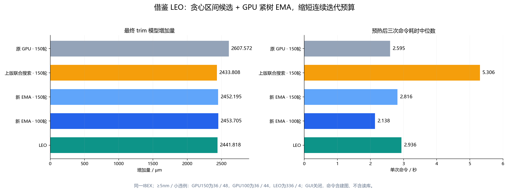
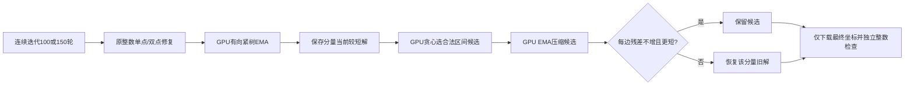

# LEO 式 GPU EMA：减少线长并控制时间

日期：2026-10-15。新方法已实现；默认参数未改，使用实验模式 `ema` / `ema_jump` / `ema_lpa`。
本次同时重测原GPU、上一版联合网络搜索和LEO，各预热后三次交替运行。

## 结论与口径

推荐先测试 **100轮 + ema_lpa**：相对原GPU150轮，增加线长减少 **153.867µm（5.90%）**，
命令时间减少 **17.60%**，≥5nm仍为36条，小违例从48条变为44条。
它没有完全达到LEO的线长：比LEO多11.887µm（0.49%），但严重违例少300条，命令快27.17%。

同一 `flow/results/asap7/ibex/base/5_2_route.odb`，DBU=1000，M2–M7，GUI/verify关闭。
普通布线原长89,786.472µm。以下“增加量”为最终trim模型绝对位移总和；本输入向外移动，
与带方向净延长量相等。各样本后验证实际dbWire未变化，未做实际布线写回。

| 配置 | 增加量 µm | ≥5nm | 0<残差<5nm | 单次命令 ms |
| --- | ---: | ---: | ---: | ---: |
| 原GPU150轮，cooperative | 2607.572 | 36 | 48 | 2594.670 |
| GPU150轮，纯EMA | 2523.749 | 36 | 48 | 2606.657 |
| GPU150轮，EMA区间跳跃 | 2519.160 | 36 | 48 | 2598.636 |
| GPU150轮，贪心候选+EMA | 2452.195 | 36 | 48 | 2816.137 |
| **GPU100轮，贪心候选+EMA** | **2453.705** | **36** | **44** | **2138.062** |
| GPU75轮，贪心候选+EMA | 2456.599 | 36 | 48 | 1840.231 |
| 上版GPU150轮，联合网络/分支预算64 | 2433.808 | 36 | 48 | 5305.886 |
| 本轮LEO默认 LPA+EMA | 2441.818 | 336 | 4 | 2935.619 |

全部GPU使用0.25W/35nm、adaptive学习率1.5→0.5、整数修复24次、双点8次；
回缩预算8。只有联合搜索对照开启 `post_joint_rounds=1, post_joint_trials=64`，其他为0。
100/75轮会改变学习率调度和连续轨迹；不能把小违例减少4条单独归因于EMA。
保留150轮的对照行用于隔离后处理效果。



## 为什么 LEO 能较快地缩短线长

核对了 `src/leo/src/lpa/Lpa.cpp`、`ema/Ema.cpp` 和 `ema/TightTree.cpp`：

1. **先选对区间。** LPA按type、松弛量、ID排序，优先尝试离理想原始位置最近的合法区间，
   每次用差分约束可行性检查确认。它直接处理区间选择，不需要150轮梯度轨迹。
2. **沿紧约束整树移动。** 一个端点回缩时，若会拉坏零slack约束，就把另一端点加入树，
   直到所有“必须跟着动”的端点都收进来；再整体移动到下一个边界。
   允许少数端点延长，只要整组增加量下降。
3. **只取首个有效改进。** 固定pivot顺序，找到可缩短的树就提交并重扫。
   不反复求解完整最小费用流，也不对大量区间组合做分支定界。

LEO只保持LPA已接受的区间；未接受的弧仍计入最终违例。
所以其短线长必须连同336条≥5nm违例一起看，不能当作已经全部满足原始图。

上一版GPU联合搜索更慢，主要因为每个候选都要做完整的网络目标求解，还要对未确定区间
计算下界并分支。用GPU实现这些步骤，并不会自动变成比紧树平移更便宜的操作。

## GPU 实现



- `ema` 仅执行C；`ema_jump` 允许树或单点直接跨过区间间隙，但落点必须满足所有关联边。
- `ema_lpa` 执行完整候选流程。区间试探只需域内差分界传播，**不运行最小费用流或分支定界**。
- 一个GPU线程拥有一个完整连通分量；复用现有CSR，只访问树关联边。
  队列和成员代次标记总空间为O(nodes)，无128节点截断。
- pivot/移动/传播均在一次设备核内完成；不逐次启动核、同步CPU或下载坐标。
- 贪心种子先用全部区间凸包计算排序上下界，再按type/slack/ID固定排序。
  对每条边按离理想位移0最近的区间逐个试探，每次从域界重新传播已接受约束。
- 与原LEO不同，任一边找不到可行区间就放弃该分量的种子；不把该弧删除后继续接受较短但更差的解。
  当前本来有残差的边最多放宽到原有残差，最终再逐边验证，不重新分配残差预算。

## 模型和伪代码

节点整数位移为\(x_i\)，硬域为\([l_i,u_i]\)。边距离与合法集合为

\[
d_e=d_e^0+2(x_t-x_s),\quad d_e\in\bigcup_r[L_{er},U_{er}].
\]

选定区间并允许该边原有残差\(g_e\)后，转成整数差分界：

\[
\left\lceil(L_{er}-g_e-d_e^0)/2\right\rceil
\le x_t-x_s\le
\left\lfloor(U_{er}+g_e-d_e^0)/2\right\rfloor.
\]

沿会被方向\(s\in\{-1,1\}\)拉坏的零整数slack边形成闭包\(T\)。
整树平移\(x_i\leftarrow x_i+s\delta\)，保持内部距离不变，只需检查跨树边和硬域。
接受条件是全部相关残差不增且

\[
\Delta L=\sum_{i\in T}(|x_i+s\delta|-|x_i|)<0.
\]

真实单向移动域上，这等同于LEO的有符号线性目标；人工双向域测试中在绝对值折点处停步，
再重新形成树，避免把穿过0后的目标斜率当成原斜率。

```text
GPU parallel for each component C:
    EMA(C):
        scan pivots in ascending node ID
        form directional zero-integer-slack closure using CSR
        bound the shift by node domains and the next |x| breakpoint
        intersect crossing-edge admissible shift intervals
        verify all affected original edges; commit first shorter move
        restart until no improvement or move budget reached

    if mode == ema_lpa:
        save EMA result as incumbent
        derive hull bounds; sort edges by type / slack / ID
        for edge in that order:
            try intervals nearest to ideal displacement first
            propagate difference bounds of accepted intervals + candidate
            if all candidates fail: retain incumbent, stop this seed
        apply feasible lower-bound coordinates
        EMA(candidate)
        if every original residual <= incumbent residual and total length lower:
            keep candidate
        else:
            restore incumbent for this component
```

跨区间平移用一维区间交的向下投影，跳到可行端点，不枚举笛卡尔积。
搜索中每次位移都先精确整数检查。种子过程的中间坐标只在设备上使用，最终提交前另做全部边检查。
移动预算为`post_retract_sweeps × 分量节点数`，本次各样本均未触及预算；0关闭该阶段。
该方法仍是局部/贪心优化，不保证全局最优，不要求逐步复现LEO的双倍DBU坐标轨迹。

## 阶段耗时与取舍

| GPU配置 | 回缩/选区间/EMA ms | 全后处理 ms |
| --- | ---: | ---: |
| 原150轮cooperative | 24.691 | 137.159 |
| 纯EMA150轮 | 34.428 | 150.494 |
| EMA跳跃150轮 | 37.565 | 153.973 |
| 贪心候选+EMA150轮 | 241.863 | 359.131 |
| 贪心候选+EMA100轮 | 241.387 | 358.694 |
| 贪心候选+EMA75轮 | 241.862 | 367.596 |

同150轮下，新完整候选比原方法多约0.221秒，增加量少155.377µm。
因此仅换后处理并没有让同预算总时间下降；再将连续预算降到100轮，才能得到本输入上
同时减少总时间和增加量的推荐组合。75轮更快，但比100轮多2.894µm、4条小违例。

表中命令时间包含建图、优化、CSV、质量检查，排除一次read_db和预热。
所有时间分别取3次中位数；不能把不同列的中位数机械相加。
LEO当前默认15W剪枝域，GPU为20W域；完整图/区间选择与违例约束并非逐项相同。
先前20W控制实验仅改变LEO长度0.025µm，见[三方法比较](three_method_extension_comparison.md)。

新100轮比上版网络搜索快59.70%，但长度多19.897µm；这是明确的质量/时间取舍。
本轮没有把11.887µm相对LEO的差距逐项作因果分摊，也没有声称达到DEL全局MIP结果。

## 使用和复现

```tcl
# 推荐实验：100轮，关闭GUI及昂贵的联合搜索
delgpu -gui 0 -max_iterations 100 -post_retract_mode ema_lpa -post_joint_rounds 0
# 纯EMA消融
delgpu -gui 0 -post_retract_mode ema -post_joint_rounds 0
```

```bash
./dev-openroad.sh build-delgpu
./dev-openroad.sh optimize --iterations 100 --post-retract-mode ema_lpa --post-joint-rounds 0
mkdir -p /tmp/delgpu-ema-benchmark
DELGPU_BENCHMARK_DIR=/tmp/delgpu-ema-benchmark \
  ./dev-openroad.sh run -no_splash -exit \
  tools/OpenROAD/src/delgpu/scripts/benchmark_ema.tcl \
  > /tmp/delgpu-ema-benchmark/benchmark.log 2>&1
python3 tools/OpenROAD/src/delgpu/scripts/summarize_ema.py /tmp/delgpu-ema-benchmark
```

默认仍为150轮/cooperative/joint关闭；`-gui 1`只在GUI已启动时显示，GUI关闭时仍仅每层一次
最终完整坐标下载，总计2,661,312字节。新模式不增加中间坐标下载。

实现：`src/optimize/EmaPostprocess.cuh`；调度和精确统计在`TrimOptimizer.cu`。
新增用例复用已有CMake/Bazel注册，覆盖250节点树、混合方向、整组延长少数节点、区间跳跃、
多区间联合种子、随机双向域/每边残差不增；全模块89个单元测试通过。
实测数据保存于`flow/reports/asap7/ibex/base/delgpu_ema/`，含24份样本CSV、日志、
`summary.json/csv/md`、构建/回归日志与源码/输入哈希。

最终验证：89项单元测试、EMA候选后的GUI更新/关闭、模式参数检查、无CUDA构建和CPU一轮运行通过；已恢复并编译CUDA模块及GUI宿主。
