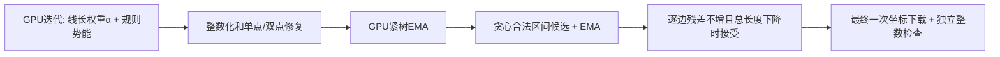

# EMA 叠加迭代线长权重，与 LEO 对照

日期：2026-10-16。在 `tmp-gpu-ema` / `fc0016e` 基础上，将 main 工作区已有的线长权重参数与 EMA 流程合并。
原 main 未提交实验保留在 stash `c9c34089007fd8c080ed026346b4dd448cf00beb`，未删除。当前默认权重仍为0.01，默认150轮/cooperative；本轮所有 EMA 配置均显式启用。

## 实测结论

在本次测试范围内，叠加权重可以继续缩短线长，但收益很小，未达到LEO线长：

- 100轮 `ema_lpa`：α=0.01→0.1，增加量2453.705→2453.232µm，仅减少0.473µm（0.0193%）。≥5nm / 小违例仍为36 / 44。
- 150轮 `ema_lpa`：α=0.01→0.02，增加量2452.195→2452.139µm，仅减少0.056µm（0.0023%）。违例仍为36 / 48。
- 100轮α=0.1比LEO默认多11.414µm（0.4674%）；150轮α=0.02多10.321µm（0.4227%）。
- 两组叠加方案的本轮命令时间中位数均比相同轮数的原权重略高；没有同时更短、更快的明显收益，保留原默认权重。

下面是预热后三次交替运行的中位数，质量指标三次完全一致。时间列各自取中位数，不机械相加。

| 配置 | 增加量 µm | ≥5nm | 0<残差<5nm | 迭代 ms | 后处理 ms | 命令 ms |
| --- | ---: | ---: | ---: | ---: | ---: | ---: |
| cooperative150 | 2607.572 | 36 | 48 | 1782.774 | 128.395 | 2553.303 |
| cooperative150_w005 | 2603.526 | 36 | 48 | 1781.733 | 129.966 | 2507.411 |
| ema_lpa100_w0.01 | 2453.705 | 36 | 44 | 1113.713 | 342.732 | 2039.942 |
| ema_lpa100_w0.02 | 2453.960 | 36 | 44 | 1154.071 | 343.084 | 2108.000 |
| ema_lpa100_w0.1 | 2453.232 | 36 | 44 | 1157.935 | 342.624 | 2088.373 |
| ema_lpa100_w2 | 2459.079 | 36 | 44 | 1124.077 | 354.322 | 2087.995 |
| ema_lpa150_w0.01 | 2452.195 | 36 | 48 | 1781.303 | 340.665 | 2710.750 |
| ema_lpa150_w0.02 | 2452.139 | 36 | 48 | 1830.435 | 347.670 | 2795.077 |
| ema_lpa150_w0.1 | 2453.009 | 36 | 48 | 1782.801 | 367.876 | 2749.927 |
| ema_lpa150_w2 | 2457.201 | 36 | 48 | 1849.441 | 354.957 | 2803.122 |
| leo_default | 2441.818 | 336 | 4 | 0.000 | 0.000 | 2908.975 |
| leo20 | 2441.843 | 335 | 5 | 0.000 | 0.000 | 3128.815 |

LEO默认剪枝域为15W；另测 `leo -prune_factor 4`，与GPU同为20W，节点/边数均为332,664 / 437,360。
20W时LEO仍留下335条≥5nm违例，GPU为36条。LEO的区间接受策略和保留的违例不同，线长和违例必须一起比较；不能把全部长度差异都归为冗余。

## 修改内容

本轮把 `-wire_weight` 串接到现有EMA分支的C++、SWIG、Tcl和启动脚本；保留该分支已有的EMA/联合搜索参数。
线长权重同时用于节点梯度、候选能量和接受判断，默认0.01。CPU参考仍使用原系数，显式传CPU此GPU参数会报错。
CSV新增 `wire_weight` 列，日志打印实际权重。标量常驻设备，不新增kernel、同步、设备数组或中间完整坐标下载。



连续迭代目标保持原形式，z为沿轨位移除以层线宽W：

$$E_\lambda(z)=\alpha\sum_i(\sqrt{z_i^2+0.01^2}-0.01)+\lambda\sum_e\phi_e(d_e^0+z_t-z_s).$$

只把线长项外部系数α变成参数；规则势能、学习率、CPU一致的35nm跳跃、硬移动域和后处理保护不变。
原来的0.01平滑尺度也不变。所有本轮配置关闭联合搜索 `post_joint_rounds=0`。

## 为什么权重收益小

EMA已经沿紧约束联动端点，压缩局部冗余；ema_lpa又生成更短的合法区间候选。
给定同一个合法区间和残差上限，最小化L与最小化αL（α>0）的最优解相同。因此系数主要通过改变前面的连续轨迹和区间落点，间接影响后处理。
EMA是有预算的局部/贪心算法，仍不能据此声称达到全局最优。最终数据接近说明本输入对单一系数不敏感，不能推广为所有设计都无收益。

过大的权重会留下更多连续残差，修复再补回部分线长。下面选取150轮的同预算样本，单位µm：

| α | 连续末态 | 整数化 | 修复后 | EMA最终 |
| ---: | ---: | ---: | ---: | ---: |
| 0.01 | 2693.709 | 2690.816 | 2754.178 | 2452.195 |
| 2 | 2475.159 | 2477.154 | 2634.604 | 2457.201 |

α=2让连续增加量减少218.550µm，最终却比α=0.01多5.006µm。
跳跃不受普通梯度能量接受条件限制；EMA候选仍必须逐边不增残差。这两处规则保持原实现，因此权重不是最终线长的单调旋钮。
进一步接近LEO，需要研究迭代中的合法区间选择和跳跃候选，而非继续单独放大α。现有数据没有把与LEO的差距逐项作因果分摊。

## 探索范围与复测

先做单次质量探索，再固定候选做三次交替复测：

- `ema_lpa`，100/150轮，每个预算测试15个权重：0.01、0.02、0.04、0.05、0.06、0.08、0.1、0.12、0.15、0.2、0.5、1、2、5、10。
- `ema` / `ema_jump`，100/150轮，每个模式和预算测试0.01、0.1、1、5。
- 共46组EMA组合做了单次探索；另有cooperative和LEO对照。
- 三次确认：ema_lpa在100/150轮分别测试0.01、0.02、0.1、2，并重测两个cooperative及两个LEO对照。
- 大权重没有改善：例如ema_lpa100的α=10为2474.929µm、36/50条违例；150轮α=10为2474.889µm、36/54。
- 其他模式也没有超过ema_lpa：纯EMA150的α=0.01/0.1/1/5为2523.749/2525.278/2545.158/2699.719µm；EMA跳跃150为2519.160/2520.676/2540.149/2693.173µm。

原始单次结果见实验目录的 `explore/summary.md`、`refine/summary.md`、`modes/summary.md`；最终三次结论只使用 `confirm/`。
第一轮探索曾直接向Windows挂载盘写大量LEO日志，观察到明显I/O开销。后续统一写入/tmp，结束后再归档，探索时间不与确认时间混用。

## 输入与统计口径

- 同一ODB：`flow/results/asap7/ibex/base/5_2_route.odb`，M2–M7，DBU/µm=1000，原始普通布线长度89,786.472µm。
- GPU：NVIDIA GeForce RTX 5060 Laptop GPU；CUDA Toolkit 12.9.1；Bazel GUI宿主，无界面运行。
- 全部GPU配置使用0.25W、35nm、adaptive 1.5→0.5、零次步长减半，后处理24/8/8。只有模式、预算和α按表变化。
- 命令时间包含建图、优化、CSV和最终质量检查，排除read_db和预热；性能实验GUI/verify均关闭，无其他GPU测试并发。
- 增加线长为trim模型的绝对位移总和；本输入域只允许向外移动，等于带方向的净延长量。没有写回真实布线，每个样本检查实际dbWire原长不变。
- ≥5nm包含恰好5nm；小违例严格为0<残差<5nm。最终按原始双倍DBU几何独立整数检查。
- GUI关闭时每层仅下载一次最终坐标，总计2,661,312bytes；本轮汇总脚本逐样本核对。
- 三次时间差没有进行显著性检验，不将几个百分点的波动解释成确定的速度收益。

## 验证与复现

- CUDA模块和GUI宿主编译通过；91项现有及新增单元测试通过。新增两项单元测试解析检查α对能量/回拉位移的作用及非法值拒绝，复用现有CMake/Bazel注册。
- α=0.01的cooperative150、ema_lpa100/150，与保存的原分支CSV逐行、逐列比较，除时间列外所有原列完全一致，证明合并没有改变原轨迹。
- 参数检查通过：零、负数、Inf、NaN、字符串及CPU显式GPU参数拒绝；EMA/联合搜索与线长权重组合可解析。
- `-wire_weight 0.1 -post_retract_mode ema_lpa` 的offscreen GUI回归通过，检查迭代更新和关闭覆盖层。
- bash语法、Python编译和git diff空白检查通过。

```tcl
# 100轮轻量叠加：相对原EMA仅减少0.473µm，默认不改
delgpu -gui 0 -max_iterations 100 -wire_weight 0.1 -post_retract_mode ema_lpa -post_joint_rounds 0
# 150轮长度最小候选：相对原EMA仅减少0.056µm
delgpu -gui 0 -max_iterations 150 -wire_weight 0.02 -post_retract_mode ema_lpa -post_joint_rounds 0
```

```bash
./dev-openroad.sh build
mkdir -p /tmp/delgpu-ema-weight
DELGPU_BENCHMARK_DIR=/tmp/delgpu-ema-weight DELGPU_WIRE_WEIGHTS='0.01 0.02 0.1 2' \
  ./dev-openroad.sh run -no_splash -exit \
  tools/OpenROAD/src/delgpu/scripts/benchmark_ema_weight.tcl \
  > /tmp/delgpu-ema-weight/benchmark.log 2>&1
python3 tools/OpenROAD/src/delgpu/scripts/summarize_ema_weight.py /tmp/delgpu-ema-weight
```

实验数据归档：`flow/reports/asap7/ibex/base/delgpu_ema_weight/`，含confirm三次样本、三组探索、构建/单元/参数/GUI验证、输入与源码/二进制哈希。
源代码入口：`TrimOptimizer.cu`的gradientKernel/moveKernel/report，参数在`Parameters.h`，实验脚本为`benchmark_ema_weight.tcl`和`summarize_ema_weight.py`。
