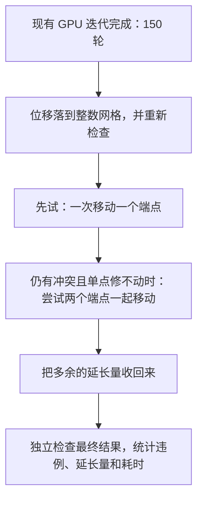
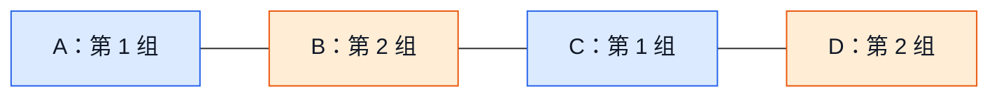
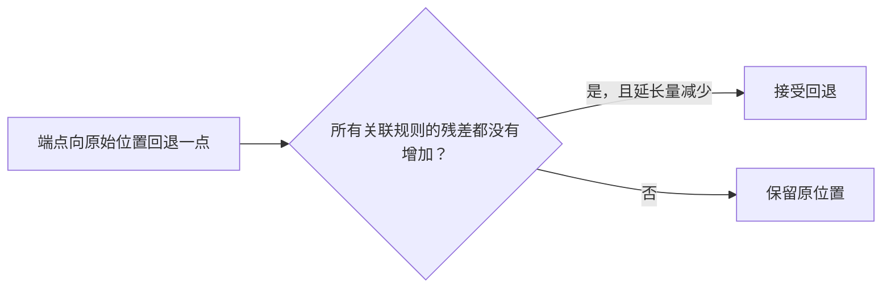

# GPU 后处理建议：整数坐标搜索与安全回缩

2026-10-15。单/双端点搜索和安全回缩已接入 GPU，默认开启。
下文保留方案设计与图解；实际结果和使用方式见 [后处理验证](postprocess_validation.md)。
连续阶段当前默认：GUI 关闭，150 轮，0.25W，35nm 跳跃，动态学习率 1.5→0.5。

## 先用一句话说明

**先用现在的 150 轮迭代把大部分位置调好，再让 GPU 对剩下的问题做小范围试探：
一个端点移不动，就试着让两个端点一起动；修完后，把多余的延长量收回来。**

这里的“端点”指图中的 trim 节点，每个节点都只能在建图时算出的移动区域内移动。
下面图中的连线表示“两个节点之间有规则需要检查”，不是实际布线。
图中的数字仅用于解释方法，不代表本工艺的完整规则或实验结果。

## 图解：后处理到底做什么

### 第一步：先落到数据库使用的整数位移网格上

前面的迭代允许使用小数位移，最后需要变成整数 DBU 位移。
可以把 DBU 理解为数据库使用的长度单位：如果连续结果移动了 8.3 DBU，
就要选移动区域内合适的整数位移，例如 8 DBU。
这里取整的是**移动量**，原始中心坐标保持原样。

取整后，有些本来刚好满足的规则可能又差一点，所以需要重新检查。
后面的修复以这份取整结果为起点。



### 第二步：移动一个端点时，把它周围的规则都检查一遍

假设 A、B、C 排成一行，AB、BC 都要求间距至少 10nm，当前位置是：

```text
位置：  A=0             B=8                    C=20 nm
        ●───────────────●───────────────────────●
             AB=8nm              BC=12nm
            差了 2nm               满足
```

现在试着移动 B：

| B 的候选位置 | AB 间距 | BC 间距 | 判断 |
| --- | --- | --- | --- |
| 保持 8nm | 8nm | 12nm | 当前有一条规则差 2nm |
| 移到 10nm | 10nm | 10nm | 两条都满足，可以接受 |
| 移到 13nm | 13nm | 7nm | 原问题消失，但另一条差 3nm；这个例子里总残差更大，拒绝 |

因此，**不能只看“我要修的那条边有没有变好”，还要看这个端点关联的所有边。**
真实规则可能有多个合法区间，候选位置会从这些区间的边界、附近位置以及回缩方向中产生。
不遍历整个移动区域，而是试少量有希望的位置。

比较两个位置时，按下面的顺序决定，前一项更重要：

1. 先减少残差 ≥5nm 的规则数量，也就是当前最关注的指标。
2. 第一项相同时，再减少所有仍有残差的规则数量，包括不足 5nm 的小违例。
3. 前两项相同时，再减少残差总量。
4. 最后再比较 trim 的延长量，越小越好。

只有按这个顺序比较后确实更好的候选才提交。
这不要求每条边都变好：修复阶段可以把一个大违例变成更小的违例，
但必须通过上述整体比较。第四步的回缩则要求每条受影响的规则都不能变差。

### 为什么 GPU 能同时处理很多端点

有直接约束的两个端点不能同时各自作决定，否则两边都按对方的旧位置计算，
一起移动后可能出问题。解决办法是先分组：**同组端点之间没有直接约束。**

例如，只有下图三条约束时，A、C 可以同组，B、D 可以同组：



先固定 B、D，让 GPU 同时处理 A、C；再固定 A、C，同时处理 B、D。
A、C 虽然都邻接 B，但分别修改 AB 和 BC 的间距，影响的规则不重叠。
如果实际图中还有 A—C 约束，就必须把它们放到不同组。
实现时通常把这种分组叫作“节点着色”。

已经没问题、附近也没有变化的节点，可以先跳过。
把计算集中在仍有冲突的端点及其附近，减少无用工作。

### 第三步：一个端点修不动，就让两个端点配合

还是用“间距至少 10nm”来说明。
假设 A 在 0nm，最多向左移动 1nm；B 在 8nm，最多向右移动 1nm：

```text
当前：        A=0  ●──────── 8nm ────────●  B=8
只移动 A：   A=-1 ●───────── 9nm ─────────●  B=8     仍不满足
只移动 B：    A=0 ●───────── 9nm ─────────●  B=9     仍不满足
一起移动：   A=-1 ●────────── 10nm ──────────● B=9   满足
```

这个例子里，单独移动一次也能减小残差，但一次不能彻底修好；
一起移动可以直接给出完整修复候选。
对于真实的多个合法区间，还可能需要两个端点一起跨到另一个合法区间，
才能越过“单独移动都不会更好”的位置。

尝试双端点移动时，也检查两端关联的所有规则。
互相没有约束联系的区域可以并行处理；有联系的同一区域，每轮选择一个最好的
双端点方案提交，避免两个方案互相影响。

### 第四步：修好后，把不必要的延长量收回来

修复冲突时，某些端点可能伸得比较远。最后再朝原始位置试着退一点：



这一步的目标是缩短延长量，条件比前面的冲突修复更保守：
不能为了缩短线长，把已经修好的规则重新弄坏，也不能加重已有违例。

## 和原 CPU 方法有什么区别

| 要比较的事情 | 原 CPU 后处理 | 这里建议的 GPU 后处理 |
| --- | --- | --- |
| 怎么决定移动 | 把每个关联区域写成数学模型，交给 LP/MIP 求解器求解 | 为端点生成少量候选位置，检查后选更好的 |
| 怎么使用并行 | 各区域的建模和整数搜索有较高开销 | 大量互不直接关联的端点同时试位置，难点再做双端点搜索 |
| 优先优化什么 | 优先减少所有严格违例 | 优先减少 ≥5nm 违例，然后处理小违例和延长量 |
| 结果保证 | 可依据求解状态判断模型是否达到最优 | 是局部搜索，可能停在还有违例的位置，不保证全局最优 |

当前 GPU 的 64 条 ≥5nm 是**进入后处理前**的结果。
实现已在同一份连续输入上进行对照实验，具体结果见验证文档；不能保证降到 0。
保留后处理开关及运行预算，GUI 继续沿用现有开关；关闭 GUI 时直接计算和输出统计，
不做中间图形刷新。实验中分别记录“取整后、修复后、回缩后”的数量和耗时，
就能看清每一步有没有价值。

---

以下保留具体实现细节，写代码时再查阅。

## 当前 CPU 后处理为何复杂

`src/del/src/optimize/Postprocess.cpp` 为每个连通分量创建 LP 压缩位移，
再创建整数 MIP。MIP 包含节点整数位移、违规开关、残差变量、每条边的合法区间
选择变量和 big-M 约束。不可全部合法时，还依次优化违规数、残差和延长量。
大量分量重复建模，且 MIP 的离散分支搜索难以直接映射为统一 GPU 核。

先前原版 DEL 的 200 轮末态为 90 条 ≥5nm，LP/MIP 后为 36 条（严格正残差 76 条）。
这属于旧输入位移及原目标函数的结果，不能作为新 GPU 后处理的实测结果。
当前 GPU 连续阶段输入后处理前为 64 条 ≥5nm。

## 推荐处理流程

### 1. 整数化并独立计数

沿用 CPU 的整数 **位移** DBU，保留原始中心可能存在的半 DBU，不强制中心为整数。
节点位移界限为 `ceil((low2-origin2)/2)`、`floor((up2-origin2)/2)`，blocked 节点固定 0。
负半整数的 ceil/floor 必须正确处理，不能直接使用 C++ 截零除法。

从连续解构造域内取整解，再独立统计整数化造成的变化。
取整可能新增违例，后续单调改进保证以整数初态为基准，不能承诺相对连续解单调。

约束距离使用原始整数数据：

```text
d2 = origin2[dst] - origin2[src] + 2*(delta[dst] - delta[src])
gap2 = 到原始 ArcRange 区间并集的最短距离
严格违规：gap2 > 0
达到 5nm：gap2*1000 >= 10*dbu_per_micron
```

计算前验证整数运算和累计范围，避免溢出。
额外上传原图的 int64 中心、区间和整数域，不能从现有归一化 double 数组反推精确几何。
复用已有 CSR 和连通分量；不重新构建 trim 图。

### 2. GPU 节点着色坐标搜索

对约束图做一次节点着色，同色节点之间没有边。按颜色依次执行，同色节点并行。
每个活跃节点从以下位置生成少量候选：

- 所有关联边合法区间边界对应的节点位置，必要时取 floor/ceil。
- 向原始位置回缩的候选、整数域端点。
- 当前位移附近少量 ±1/2/4/8 DBU 候选，补充边界附近的小范围移动。

候选必须在硬移动域内，并检查该节点的 **全部关联边**，使用字典序目标：

```text
(残差>=5nm的边数, 严格正残差边数, 残差总量, trim延长量)
```

只提交目标严格改善的候选，完全相等时保留原位置。计数全部采用整数残差。
同色节点不相邻，因此它们影响的边集合不重叠，局部目标变化可以相加；
相邻节点不能在同一颜色内同时提交。不同颜色在同一 stream 中有序执行。

只激活违规边端点及其邻域；移动后标记关联边和邻居供后续处理，使用独立的下一轮
活跃标记避免清零时丢失新任务。阶段末做完整扫描验证活跃集没有遗漏。

这与先前盲目投影不同：投影只是候选生成手段，接受条件必须考虑所有关联边的
精确离散目标，不能只看当前修复边是否变合法。

### 3. 残余冲突的双端点搜索

单节点更新停滞后，只处理残余冲突所在分量。对 B/C 的其他合法分支、合并点和
区间边界，尝试同时移动两个端点，按域容量生成少量分摊方案。
评估两端关联边的并集，去重后计算目标变化。

每个分量并行评估多个候选，但每轮只提交该分量最优的一个改善候选；
不同分量之间并行，无共享节点或边。
不能仅凭两条边端点不重叠就同时提交两个双端点移动：两组端点之间可能还有约束边。
按分量择一提交可避免为这种耦合引入复杂锁或更高阶着色。

首版只实现单节点与双端点更新。若实测仍有明显局部极小值，再针对少量难分量
加入有界小邻域组合搜索，统一在最终组合目标改善后提交，不引入通用分支定界器。

### 4. 安全回缩降低延长量

修复结束后沿节点颜色扫描，生成朝原始位置的回缩候选。
要求所有关联边的新残差均不超过旧残差，且延长量下降，才允许提交。
也可固定当前区间分支，求各关联约束允许位置的交集，再投影到最靠近原点的整数位置。
这样回缩阶段不以牺牲已获得的合法性换取短线。

## 并行与工程范围

- 位移、活跃标记、候选和评分常驻 GPU；复用现有单 stream 和 CSR。
- 短邻接节点可一线程或一 warp，按度数分桶后再决定是否优化高阶节点。
- 仅双端点残余搜索按连通分量调度，避免整个流程都受单个大分量串行限制。
- 插入位置在连续迭代结束、最终坐标下载之前；GUI 关闭时不增加中间坐标传输。
- 最终由独立 CPU 整数检查器校验原始移动域与所有原始 ArcRange，显示使用整数结果。
- 保留后处理开关和预算，分别报告连续末态、整数初态、修复末态和回缩末态。

## 验收口径

首先在 **同一份当前 GPU 连续末态** 上对比关闭后处理、仅取整、GPU 搜索和 CPU
参考后处理，不能把不同连续输入的旧 CPU 最终结果直接相减。
统一报告 ≥5nm 数量、严格 0<残差<5nm 数量、严格正残差总数、最大/总残差、延长量及端到端耗时。
CPU 原 MIP 优先最小化严格违规数；上述方案优先 ≥5nm 数量，需注明目标顺序差异。

时间必须包含整数化、候选/索引准备、修复、回缩和最终检查；保持 GUI 关闭，
预热后交替重复测量，再决定默认预算。
这里采用启发式局部搜索，不提供 MIP 的全局最优证明，也不保证所有分量完全合法。
它的可检验保证是整数域合法，以及相对整数初态的目标不变差；实际质量和速度需实验。
