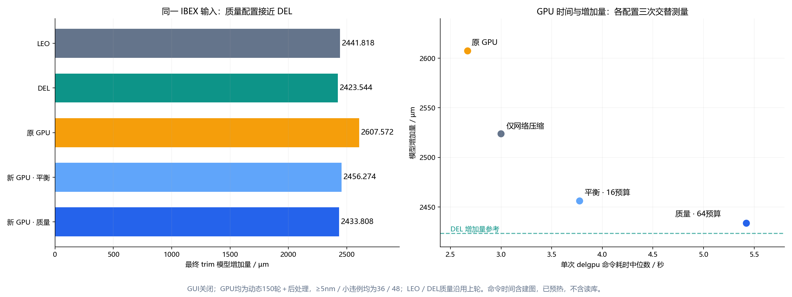
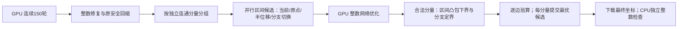

# 将 DEL 的区间优化思路改造成 GPU 联合搜索

日期：2026-10-15。实现已编译并在同一 IBEX 输入验证。没有把 CPU MIP 求解器搬到 GPU；
采用原问题的差分约束结构，构建 GPU 原生的区间搜索和网络优化。
当前通过实验开关启用，原有默认参数保持不变。

## 结果先看

输入：`flow/results/asap7/ibex/base/5_2_route.odb`，M2–M7，DBU=1000，
普通布线原长 89,786.472µm。比较最终 trim 模型的 `sum(abs(displacement))`，
不是连续阶段长度，也不是已写回的新 dbWire。当前输入只允许向外移动，该值等于带方向净延长量。

| 方法 | 最终增加量 µm | ≥5nm | 0<残差<5nm |
| --- | ---: | ---: | ---: |
| LEO 默认 LPA+EMA | 2441.818 | 336 | 4 |
| DEL200 + LP/MIP | 2423.544 | 36 | 40 |
| 原 DELGPU150 + 修复/协同回缩 | 2607.572 | 36 | 48 |
| 新 GPU 平衡配置：1轮，16候选/分支预算 | 2456.274 | 36 | 48 |
| 新 GPU 质量配置：1轮，64候选/分支预算 | **2433.808** | **36** | **48** |

LEO、DEL 数值沿用[上一轮同输入的三方法实测](three_method_extension_comparison.md)；
本轮重新测量四种 GPU 配置，各三次，逐层质量完全重复。GPU 连续阶段仍为默认动态150轮、
0.25W、35nm、学习率1.5→0.5，修复24次、双点8次、协同回缩8次，GUI/建图校验关闭。

质量配置比原 GPU 减少 **173.764µm（6.6638% 的增加量）**；
比 LEO 短 **8.010µm**；比 DEL 多 **10.264µm（0.4235%）**。
它仍比 DEL 多8条小违例，不能称为与 DEL 完全相同或全局最优。



## 运行时间与预算

GPU：NVIDIA GeForce RTX 5060 Laptop GPU。先用质量配置预热一次，再正反顺序交替运行，
每种配置3次。以下均为中位数，CSV/日志记录每个样本。

| 配置 | 增加量 µm | 新联合阶段 ms | 全后处理 ms | 优化 total_ms | 单次 delgpu 命令 ms |
| --- | ---: | ---: | ---: | ---: | ---: |
| baseline：joint_rounds=0 | 2607.572 | 0 | 144.368 | 2164.840 | 2668.985 |
| network：1轮，2预算 | 2523.814 | 329.744 | 480.884 | 2505.186 | 2996.885 |
| balanced：1轮，16预算 | 2456.274 | 1105.652 | 1254.714 | 3275.145 | 3773.323 |
| quality：1轮，64预算 | 2433.808 | 2742.547 | 2893.690 | 4914.503 | 5421.701 |

`total_ms` 包含初始化优化器、连续迭代、后处理、下载和独立主机检查，排除建图。
“命令 ms”再包含建图；二者都不包含读库、首轮 CUDA 初始化或 GUI 绘图。
增加联合搜索会增加耗时：平衡配置命令多约1.104秒，质量配置多约2.753秒。
本轮未重复测量 LEO/DEL 时延，不据此声称同阶段 CPU/GPU 加速比。

另一次单次预算扫描中，4轮×64得到2430.798µm，命令约12.450秒；
相对1轮×64只再省3.010µm，不作为推荐配置，也不与上述中位数混用。

## 借鉴 DEL 的什么部分

DEL 后处理先固定区间做 LP 压缩，再用整数 MIP 重新选择每条边的合法区间并联合求位置。
原 GPU 回缩通常固定当前分支，因此即使多扫几次，也可能停在较长解上。

新方法保留“区间选择 + 整分量联合位置求解”的结构：



主机准备整数几何、确定性分组、分量大小桶及启动核；数值求解和候选坐标保留在 GPU。
没有调用 OR-Tools、HiGHS、SCIP 或其他 CPU LP/MIP 后端。

## 形式化描述

令节点整数位移为 \(x_i\in\mathbb Z\)，硬移动域为 \([l_i,u_i]\)，blocked 节点固定为0。
边 \(e=(s,t)\) 的原始双倍 DBU 距离为 \(d_e^0\)，合法集合为区间并集：

\[
d_e=d_e^0+2(x_t-x_s),\qquad d_e\in\bigcup_{r\in R_e}[L_{er},U_{er}].
\]

选定一个区间后：

\[
\left\lceil\frac{L_{er}-d_e^0}{2}\right\rceil
\le x_t-x_s\le
\left\lfloor\frac{U_{er}-d_e^0}{2}\right\rfloor.
\]

区间无界侧不添加对应约束。半 DBU 边界精确取整，空整数区间不可行。
每个界都能写成 \(x_v-x_u\le b_{uv}\)，增加零锚点后，硬移动域也是同类约束。
本设计的域为单向向外，故 \(\sum_i|x_i|=\sum_i c_i x_i\)，\(c_i\in\{-1,1\}\)。
对人工双向域测试，仅搜索当前符号区域，保持目标线性；不宣称覆盖所有符号组合。

固定区间的整数最短延长问题：

\[
\min_x c^Tx\quad\text{s.t. }x_v-x_u\le b_{uv},\ x\in\mathbb Z^n.
\]

其网络对偶是以 \(b_{uv}\) 为费用、以 \(c_i\) 为供需的最小费用流。
实现使用整数可行势初始化和逐次最短增广路；恢复的整数势即节点位置。
原始约束弧容量取大于总供给的值，增广不会删掉原始硬约束。
候选并行时每线程解一个小网络；分支定界时由一个 warp 协同处理共享内存中的网络。

对尚未选定分支的边，把合法区间并集放宽成区间凸包，得到可计算的长度下界。
如果下界已不小于当前可行长度，就剪去整个子树；否则检查放宽解是否落入全部原合法区间。
若某条边落在区间间隙中，就对该边分支，再继续求网络下界。
这继承 MIP 的下界/分支/剪枝思路，同时利用了本问题的网络结构，不需要通用 big-M 模型。

## 伪代码

```text
for round in joint_rounds:
    GPU parallel for each eligible component C:
        generate <= T interval assignments
          incumbent branch; strict legality; zero/half-displacement seeds;
          complete enumeration if small, otherwise one-edge branch flips
        for each assignment in parallel:
            solve integer difference-bound network for minimum extension
            keep only domain-valid, edgewise nonworsening, nonlonger solutions

        if C was already completely legal and T >= 4:
            best = best feasible candidate/old solution
            DFS stack = empty; all interval branches initially unassigned
            repeat at most T network states:
                solve interval-hull relaxation -> integer optimum and lower bound
                if infeasible or lower_bound >= best.length: backtrack
                else if optimum satisfies all original legal interval unions:
                    best = optimum; backtrack
                else:
                    split a violated interval union, visit nearest branch first
                if next depth would exceed 64: skip that subtree and backtrack
            stop if DFS exhausted or the state budget is consumed
            remember fully explored outward-domain components for later rounds

        commit the best candidate, using the original integer geometry score
CPU independently checks only the final downloaded positions
```

\(T=\texttt{post_joint_trials}\) 分别限制并行候选数和分支定界状态数，
不是二者相加后的全局上限；单分量单轮最多约 \(2T\) 次网络求解。
分支定界只处理原本完全合法的分量。对仍有违例的分量，区间候选最多放宽到该边当前残差，
并要求每条边残差不增、总长度不增；不会为省线长牺牲已经达到的合法性。

## 效率和正确性边界

- 按16/32/64/128节点、64/128/256/512边四档组织 GPU 工作，降低小分量的工作区开销。
- 分支定界一个 warp 处理一个分量，共享网络与搜索状态；最短路使用 warp 归约。
  距离和前驱弧打包原子更新，避免平行边竞争导致不一致路径。
- 当前最多128节点、512边；本输入仅M2的8个分量超限，其他层均覆盖。
  超限分量保留原后处理结果；不回退调用 CPU MIP。
- 深度上限64、状态预算2–64；预算耗尽保留已找到的较好可行解。
  搜索完全结束且满足单向域条件的分量才可标记完成，后续轮次跳过。
- 原始几何和全部候选/检查使用 int64 DBU 或双倍 DBU，不用浮点容差判断违例。
  ≥5nm 与严格0<残差<5nm分开统计。
- 默认关闭联合实验时不准备对应分组，不申请搜索缓冲、不启动搜索核。
  开启后新增 `joint` CSV阶段，最终报告和 GUI 都采用它的坐标。
- GUI开关不改变搜索；GUI关闭时最终完整坐标下载总量仍为2,661,312字节，即每层一次。
  实际 dbWire 长度在每个样本后检查未变化。

本输入的新质量结果仍有36/48条违例。它不是求解 DEL 的完整 MIP：没有在困难分量间或边之间
重新分配违例/残差预算，还受分量规模、搜索预算及深度限制。因此仍有10.264µm的长度差距。
不能把这个差距全部归因于其中某一项，本轮没有逐项因果消融。

## 分层质量配置

| 层 | DEL µm | 原 GPU µm | 新 GPU µm | 新 GPU 比 DEL 多 |
| --- | ---: | ---: | ---: | ---: |
| M2 | 1622.235 | 1775.271 | 1632.149 | 9.914 |
| M3 | 478.835 | 497.373 | 478.911 | 0.076 |
| M4 | 113.563 | 117.388 | 113.563 | 0 |
| M5 | 64.511 | 65.872 | 64.511 | 0 |
| M6 | 134.922 | 141.472 | 135.196 | 0.274 |
| M7 | 9.478 | 10.196 | 9.478 | 0 |
| 合计 | 2423.544 | 2607.572 | 2433.808 | 10.264 |

## 使用和复现

```bash
./dev-openroad.sh build-delgpu
# 推荐先比较这两种预算；默认连续阶段和原后处理参数均保留。
./dev-openroad.sh optimize --post-joint-rounds 1 --post-joint-trials 16
./dev-openroad.sh optimize --post-joint-rounds 1 --post-joint-trials 64
# 原基线
./dev-openroad.sh optimize --post-joint-rounds 0
```

```tcl
# GUI控制台按需要改为 -gui 1；默认仍为0。
delgpu -gui 0 -post_joint_rounds 1 -post_joint_trials 64 -report /tmp/joint.csv
```

`post_joint_rounds` 接受0–64，默认0；`post_joint_trials` 接受2–64，默认16。
CPU后端或关闭postprocess时拒绝启用联合搜索；max_iterations=0仍只建图。

```bash
# ORFS根目录，预热一次，四种配置各三次，正反顺序交替。
mkdir -p /tmp/delgpu-joint-benchmark
DELGPU_BENCHMARK_DIR=/tmp/delgpu-joint-benchmark \
  ./dev-openroad.sh run -no_splash -exit \
  tools/OpenROAD/src/delgpu/scripts/benchmark_joint.tcl \
  > /tmp/delgpu-joint-benchmark/benchmark.log 2>&1
python3 tools/OpenROAD/src/delgpu/scripts/summarize_joint.py /tmp/delgpu-joint-benchmark
```

数据保存于 `flow/reports/asap7/ibex/base/delgpu_joint/`，包含各配置各样本CSV、
日志、`summary.json/csv/md`、构建/回归记录和源码/ODB哈希。
汇总脚本检查原修复/回缩输入完全一致、整数阶段单调性、三次质量可重复及最终坐标下载次数。

关键实现为 `src/optimize/JointPostprocess.cuh` 和 `TrimOptimizer.cu`；
`Postprocess.cpp` 准备分量索引，`RunOptimization.cpp` 连接统计、独立验证和显示。
新增单元用例复用现有 CMake/Bazel PostprocessTest 注册，包括固定区间与多区间的独立穷举
最优值校验、耦合分支、负环/半DBU、四种工作桶及超限回退、大整数费用距离。
GUI回归覆盖联合优化后显示更新及关闭显示；参数回归覆盖预算边界与不兼容组合。

最终检查：84个单元测试通过；offscreen GUI更新/关闭检查、参数边界检查、CPU无CUDA构建与1轮运行通过；CUDA模块与GUI宿主已重新编译。
