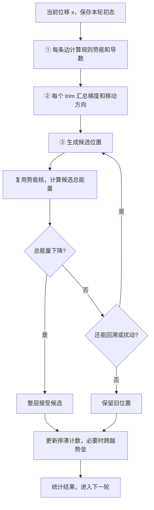

# Trim CUDA 简化方案：算势能、求梯度、尝试移动

更新日期：2026-10-15。当前修复已采用本文的 CPU 语义方案：分量之间并行，分量内按原边顺序跨势垒，并立即清零关联计数。GPU 默认取消步长减半重试，可用 `-max_backtracks 19` 恢复完整预算；连续阶段返回末态，尚未接入 LP/MIP。实测结果见 [跳跃与回溯实验](cpu_jump_validation.md)。本文文末的边着色投影和历史快照策略属于旧实现。

**推荐实现：3 类核心核函数 + 2 类修复核函数，单 GPU、单 stream、常驻数组。** 扰动放进移动核，候选评估复用势能核，求和与最大值使用库归约，接受候选时交换指针。以减少开发量、数据传输和重复计算为主要目标。

## 1. 整个流程只围绕三个步骤

CPU 初始化一次：构图、创建 trim、计算初始距离和移动域，整理邻接表并上传 GPU。之后每轮执行：



这里需要区分：**移动域是硬边界，A/B/C 规则通过软势能推动满足。** 候选位置可以仍有违规，只要整层总能量达到下降门槛。一次候选更新的所有 trim 都读取同一份旧坐标。

完整 DEL 流程仍是：CPU 构图 → GPU 连续迭代 → CPU LP/MIP 后处理。GPU 加速范围是中间的连续阶段。

## 2. 三类核心核函数

记节点数为 N、边数为 E。`x[i]` 是累计位移除以层线宽 W，初始化为 0；实际中心为原始中心加 `W*x[i]`。图和移动域在本次运行中固定，每层独立计算能量和步长。

| 步骤 | 核函数 | 并行方式 | 主要工作 |
|---|---|---|---|
| ① 算规则势能 | `potentialKernel` | 一线程一条边 | 算距离、势能；需要梯度时再算导数 |
| ② 求梯度 | `gradientKernel` | 一线程一个 trim | 加移动代价，汇总关联边导数，生成受限方向 |
| ③ 尝试移动 | `moveKernel` | 一线程一个 trim | 从旧位置生成候选，加入可选扰动，计算候选移动代价和移动标记 |

表中是 **3 类计算职责，不是每轮只启动 3 次核函数**。回溯需要重复调用，库归约也有自己的核启动。

### ① potentialKernel：边上计算

每条边 e=(s,t) 独立计算：

```text
d[e] = d0[e] + x[t] - x[s]
(phi[e], phi_prime[e]) = rulePotential(type[e], d[e], threshold)
```

`d0` 初始化时预计算；规则函数直接复用 CPU 的数学定义：

```text
A: LB(d, D/W)
B: d<0 ? LB(d,0) : Bump(d,0,Dt/W)
C: d<0 ? Bump(d,-Du/W,0) : Bump(d,0,Du/W)
```

核函数提供小范围的编译期开关：初态评估计算势能和导数，候选评估只计算势能，轮末报告再附带合法区间残差和违规统计。共享一套设备函数，避免维护三份公式。候选阶段不算完整违规报告。

### ② gradientKernel：节点上汇总

每个节点线程先算自身的移动代价及梯度，再按 CSR 邻接表收集所有关联边：

```text
node_energy[i] = 0.01 * (hypot(x[i],0.01) - 0.01)
g[i] = 0.01*x[i]/hypot(x[i],0.01)
for e in incident_edges[i]:
    g[i] += (i==src[e] ? -1 : +1) * lambda * phi_prime[e]
q[i] = 1 + 关联边数
p[i] = clamp(-g[i]/q[i], low[i]-x[i], up[i]-x[i])
```

CSR 就是把每个 trim 的关联边放在连续数组的一段，用 offsets 记录起止位置。一个线程独占一个节点的输出，可避免浮点 `atomicAdd` 和共享节点的写竞争。q 初始化时计算，核内直接读取。邻接边按 CPU 原边顺序存储；不重排节点，扰动直接使用原节点编号。

本核合并移动代价、梯度汇总、度数缩放和移动域投影。随后用库归约得到三个量：

```text
old_rule_energy = sum(phi)
old_energy = sum(node_energy) + lambda*old_rule_energy
M = max(abs(p))
S = M>max_step_w ? max_step_w/M : 1
```

`old_energy` 和 `old_rule_energy` 保存到专用标量，候选计算不覆盖它们。S 的计算可在移动核中读取设备端 M 完成。

### ③ moveKernel：候选更新、回溯和扰动

普通更新与扰动使用同一个核：

```text
attempt = 0,1,2                   # 普通更新，再试两种确定性扰动
j[i] = 0                          # attempt=0
j[i] = ((i+attempt)%2==0 ? +0.01 : -0.01)  # attempt=1,2
h = S * 2^(-backtrack)             # backtrack=0..19
trial[i] = clamp(prev[i] + clamp(h*(p[i]+j[i]),
                               -max_step_w,+max_step_w),
                 low[i],up[i])
```

核同时输出候选的节点移动代价，以及 `abs(trial[i]-prev[i])>1e-12` 的移动标记。**每次尝试都从 prev 生成，失败候选不作为下一次起点。**

然后复用 `potentialKernel` 的 energy-only 路径计算候选边势能，归约总能量和移动数量。CPU 每次候选只读回一次小摘要，执行：

```text
没有节点移动：结束当前 attempt 的回溯
new_energy < old_energy - 1e-12*max(1,old_energy)：接受并结束梯度阶段
否则：缩小步长，直到本 attempt 的回溯用完
普通更新未成功且 old_rule_energy==0：结束，不再扰动
```

接受时交换 `current` 与 `trial` 指针；全部失败则 `current` 不变。接受条件针对整层，不能让每个节点或连通分量各自接受。

首版为减少主机往返，在一次候选链里同时计算移动数和能量，再统一下载；即使没有移动，也执行这次能量评估。这个小量冗余换掉了“先读移动数、再读能量”的两次等待，不改变有限数值下的接受逻辑。

## 3. 两类辅助核函数：停滞检测、有序修复

| 核函数 | 并行方式 | 工作 |
|---|---|---|
| `stallKernel` | 一线程一条边 | 比较本轮初态与梯度结束位置，更新停滞计数 |
| `repairKernel` | 一线程一个有边连通分量 | 分量内按原边顺序执行跨势垒跳跃 |

### 停滞检测

边的两端都没有可见移动，并且旧、新距离都达到修复容差的违规标准，计数加一，最大为 3；否则清零。

```text
visible_moved(i) = llround(W*current[i]) != llround(W*prev[i])
violated(e,x) = gap(e,x)>0 && W*gap(e,x)>=repair_tolerance_dbu
gap = 到该边全部合法区间的最小距离
```

`gap` 使用现有 `ArcRange`，初始化时换算边界并扁平存储。舍入使用与 CPU `llround` 相同的半整数远离零规则，分别舍入两份累计位移。

直接在边线程里完成这些短计算，不单独建立可见移动数组或启动可见移动核。达到 3 时，用整数 `atomicExch` 标记该边所在分量活跃；分量标记每轮清零。**全部计数更新完成后才开始修复。**

### 停滞修复

初始化时用全部约束边建立无向连通分量，保存各分量按原边编号排序的边列表。孤立节点没有修复工作。

`repairKernel` 中，不活跃分量立即返回；活跃分量由一个线程按顺序执行现有 [StallRepair.cpp](../src/optimize/StallRepair.cpp) 的跳跃逻辑：

- B 的正距离禁区和 C 的非零禁区，尝试跳到势垒中点另一侧；A 和负距离 B 不做这种跳跃。
- 保留跳跃偏移的单位换算、移动域容量检查、按 q 分配两端位移、舍入容差和双端点提交校验。
- 成功后，只为实际移动端点清零全部关联边的停滞计数；处理下一条边时重新读取当前坐标和计数。
- 跳跃保持当前语义：不套用普通梯度最大步长，也不要求整层能量下降；成功跳跃不代表立即合法。

不同分量没有共享节点，可以并行；同分量内部保留原顺序，避免两条边同时修改同一个 trim。这里的串行性是现有修复算法的状态依赖。大分量可能形成尾部耗时，需要测量；首版不增加图着色、锁或多种修复调度器。

修复统计写入每个分量自己的记录，最后归约。轮末复用势能核的报告模式和节点核的 report-only 模式，计算修复后的能量、违规数、总位移，以及相对 prev 的净移动；report-only 跳过 CSR 梯度汇总。`accepted` 在梯度接受或至少一次修复成功时为真，最大修复位移单独统计。这样仍只有上述 5 类自定义核函数。

## 4. 数据与同步保持简单

所有设备内存初始化时申请，迭代中复用。原始双倍整数中心留在 CPU；GPU 数值使用 double，保留 `hypot` 计算方式，不启用 fast-math。

| 数据 | 保存内容 |
|---|---|
| 静态节点数组 | low、up、q；节点编号沿用 CPU |
| 静态边数组 | src、dst、type、d0；各层预计算规则阈值 |
| 邻接与区间 | CSR offsets/edge_ids；扁平 ArcRange 边界与标志 |
| 修复索引 | 分量边列表、边对应的分量编号 |
| 常驻工作区 | prev/current/trial、方向、边势能/导数、节点临时结果、停滞计数、活跃标记、归约空间和摘要 |

current 和停滞计数初始化为零。保留三个坐标数组：轮开始把 current 设备内复制到 prev；trial 存候选；current 存已接受结果并供修复修改。prev 在本轮只读，避免接受、失败和修复路径互相覆盖。

库归约统一封装为少量 sum/max 操作，使用现有 Toolkit 所带 CUB 的 `DeviceReduce`，不自己写全局归约；接口以本地 CCCL 版本为准，参考 [NVIDIA CUB 设备级算子](https://nvidia.github.io/cccl/unstable/cub/api/device.html)。

核函数、归约和复制都进入同一个显式 stream，阶段间按入队顺序执行，不在每个核后调用 `cudaDeviceSynchronize`。CPU 只在读取候选摘要、轮末统计或坐标快照时等待该 stream。这个顺序由 [CUDA stream 执行语义](https://docs.nvidia.com/cuda/cuda-programming-guide/02-basics/asynchronous-execution.html#cuda-streams)保证。

候选摘要使用常驻的页锁定主机缓冲区，第一次下载顺带返回旧能量和旧规则能量，之后保留这份旧状态。空节点/空边归约显式返回零，未使用的临时统计清零；非有限数值与 CUDA 执行错误返回主机报错。

一次整层迭代的调度就是：

```text
设备内复制 current -> prev
potentialKernel(prev, 计算导数)
gradientKernel(prev)
归约旧能量、旧规则能量、最大方向

按原 attempt/backtrack 顺序：
    moveKernel(prev -> trial)
    potentialKernel(trial, 仅能量)
    归约候选能量与移动数，读回一次小摘要
    按第 2 节判断；接受则交换 current/trial，退出尝试

清空分量活跃标记和本轮修复统计
stallKernel(prev, current)
repairKernel(current)
potentialKernel(current, 报告模式)
gradientKernel(current, report-only，与 prev 比较净移动)
归约并读回本轮统计；按需下载坐标
```

第 0 轮只评估和显示初态，不移动。每层使用自己的缩放、能量与接受条件，继续沿用现有 lambda 调度和迭代预算。

## 5. 高性能与性价比来自哪些地方

| 做法 | 收益 |
|---|---|
| 静态图一次上传，坐标常驻 GPU | 消除每轮全量传输与重复构图 |
| 三个核心步骤各自合并相关操作 | 少启动短核，少读写中间数组 |
| 候选复用势能核，只求能量 | 失败候选不计算导数、残差和完整报告 |
| CSR 汇总，单线程拥有节点输出 | 梯度阶段无浮点原子竞争，无额外清零核 |
| 扰动共用移动核，接受使用指针交换 | 不增加扰动核、提交核或整层候选复制 |
| 修复留在 GPU，按分量有序执行 | 避免每次修复来回传整套坐标和计数 |
| 单 GPU、单 stream、复用 CUB | 减少开发和维护成本 |

线程块先用 256 线程，一线程一边/节点；实际测量后再比较 128。每轮复杂度约为 `O((1+R)*(N+E))`，R 是实际候选数，另外加修复扫描及关联边清零成本。

已有样例约 32.9 万节点、43.1 万边，平均每节点关联约 2.62 条边，适合从简单 CSR 汇总开始。单份 double 坐标约 2.63 MB，三份约 7.89 MB；总显存再加图、区间和库工作区，实施时按实际分配统计。

**接入时必须把 step 与坐标下载分开。** 当前 `RunOptimization.cpp` 每轮无条件调用 `displacementDbu()`；GPU 后端应让日志只读取小统计，无 GUI 的连续运行只在最终报告和后处理前下载完整坐标。GUI 单步仍下载当前快照，连续显示按显示请求获取，保持停止与数据库销毁处理。

首版 CPU 每候选读一次摘要，仍有主机等待。如果实测等待/启动开销成为主要部分，再捕获一次候选链的 CUDA Graph，降低提交开销；CPU 回溯判断仍需等待摘要。设备条件回溯、多 stream、多 GPU、混合精度均留到确有收益证据时再做。

根据[现有 CPU 日志](runtime_analysis_metrics.json)，连续阶段约 40.17 秒，后处理约 188.59 秒，总耗时约 234.49 秒。若其他阶段和工作量不变，连续阶段加速 10 倍对应整体约 1.18 倍；把连续阶段耗时降为零的上限约 1.21 倍。这是固定其他阶段的估算，实际优化轨迹也可能影响后处理耗时。方案优先改善每轮计算与交互响应，完整 DEL 提速还需单独优化后处理。

## 6. 最小实现范围与验收

复用 `src/delgpu` 的 CUDA 构建与资源管理，在此基础上新增以下主体文件：

| 建议文件 | 内容 |
|---|---|
| `src/delgpu/include/delgpu/TrimOptimizer.h` | 普通数组形式的输入、step/统计/快照接口，不依赖 OpenDB 或 GUI |
| `src/delgpu/src/TrimOptimizer.cu` | 五类核、公共势能/gap/跳跃设备函数、归约与主机回溯调度 |
| `src/del/src/optimize/GpuAdapter.cpp` | CPU 图打包、后端选择、与现有日志/显示/后处理连接 |

补充 CMake/Bazel 目标和 CPU/GPU 差分测试，复用已有 `ENABLE_DELGPU_CUDA` 开关，保持 CUDA 可选及 CPU 路径可用。GUI、Tcl 和 OpenDB 继续由主机代码处理。数据库释放时先结束相关设备任务再销毁资源，运行中 CUDA 失败不静默切换到陈旧 CPU 状态。

实施分两步就够：

1. **跑通三步主循环**：三个核心核、CUB 归约、GPU 常驻状态、主机回溯和内置扰动。先验证单边、单节点、单候选，再比较一轮和多轮结果。
2. **补齐可交付流程**：两类修复核、最终统计、按需快照、CPU 后处理接入；完成真实样例正确性和端到端性能测量。

重点覆盖 B/C 中点、blocked 节点、越界截断、全部候选失败、零移动、扰动才成功、三轮停滞、共享端点修复、负距离 C、半 DBU 舍入和自定义 ArcRange。GPU 浮点归约顺序可能改变临界接受分支，需要比较分支和最终质量，不能承诺与 CPU 逐位一致。

验收报告只需回答三个问题：**结果是否正确；连续阶段实际快多少；初始化、等待和数据传输是否值得。** 固定输入、迭代预算及显示/日志配置，分别记录实际候选数、核心计算/修复耗时、主机等待、传输量、最终违规数和位移，并同时报告连续阶段与整套 DEL 耗时。若总耗时不降，就依据测量定位瓶颈，再决定是否增加优化机制。


## 7. 当前实现相对于原方案的调整

实际入口：`include/delgpu/TrimOptimizer.h`、`src/optimize/TrimOptimizer.cu`、
`src/optimize/GpuAdapter.cpp`、`src/optimize/RunOptimization.cpp`。

- 保留常驻状态、CSR 无浮点原子梯度、单 stream、CUB 归约和候选指针交换。
- 最多八次回溯以限制等待；统计采用一次结构归约组合求和与最大值。
- 停滞修复采用边着色匹配，各颜色顺序执行、同色边并行独占端点，替代分量内串行。
- 每三轮对停滞约束投影到最近可达合法区间，包含 A 和小残差；不局限于 B/C 跨中点。
- 冲突数最少的快照独立保留，结束时恢复并执行最终主机域/残差检查。
- `-gui 0` 不创建显示副本，只在最终检查下载坐标。`-gui 1` 的快照按 `-frame_ms` 节流。
- `-max_iterations 0` 保留纯建图；默认连续迭代 200 轮，可选 CPU 参考后端和 CSV。
- LP/MIP 后处理不属于本次第二阶段实现，尚未接入。


应用默认值现为 `max_iterations=200`、`max_step=0.25W`、`jump_offset_nm=35`。
CPU 保留原跨势垒修复；GPU 保留合法区间投影，并在无可达合法目标时使用此偏移
生成 B/C 跨势垒候选。偏移换算和目标可达性已覆盖单位测试。
实测见 [默认参数验证](default_parameters_validation.md)。
