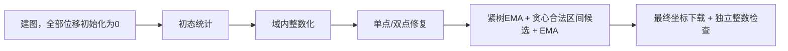

# 跳过连续迭代：直接整数修复 + EMA

2026-10-16，`tmp-gpu-ema` 分支。在当前EMA/线长权重实现上增加显式 `-postprocess_only 1`，从原始trim位置直接执行后处理。

## 实测结果

同一IBEX输入，关闭GUI和verify，预热后三次交替运行。三次质量完全一致，时间为各列独立中位数。

| 配置 | 增加线长 µm | 总违例 | ≥5nm | 0<残差<5nm | 最大残差 nm | 连续迭代 ms | 后处理 ms | 命令时间 s |
| --- | ---: | ---: | ---: | ---: | ---: | ---: | ---: | ---: |
| EMA 100轮 | 2453.232 | 80 | 36 | 44 | 17 | 1144.987 | 345.516 | 2.062 |
| EMA 50轮 | 2464.489 | 84 | 36 | 48 | 19 | 532.147 | 360.113 | 1.470 |
| 仅后处理（0轮连续迭代） | 2478.065 | 80 | 44 | 36 | 35 | 0.000 | 360.105 | 0.985 |
| LEO默认20W | 2441.843 | 340 | 335 | 5 | 58 | — | — | 2.997 |

- 仅后处理相对100轮：命令时间少52.23%，增加线长多24.833µm（1.012%），≥5nm多8条，最大残差17→35nm。
- 相对50轮：命令时间少32.98%，增加线长多13.576µm（0.551%），≥5nm同样多8条。
- 原始总违例104,657条，经仅后处理降至80条。与100轮总数相同，但严重违例36→44、小违例44→36，不能因此称质量相同。
- 本次零轮最差残差35nm，残差总量906nm；100轮为17nm/500nm，50轮为19nm/564nm。
- 如果仍要求≥5nm数量维持36条，零轮不满足该目标；50轮保留该数量且显著快于100轮。更低轮数取舍见[轮次扫描](ema_iteration_budget_validation.md)。

LEO默认已是20W，其结果与显式 `leo -prune_factor 4` 相同。LEO保留更多严重违例，比较时需同时看长度与违例。

## “100轮”与“100轮加后处理”的区别

上表的“EMA 100轮”包含连续迭代100轮、整数化、整数修复、EMA回缩。另行以 `-postprocess 0` 实测仅100轮，独立主机检查得到：

| 阶段 | 增加线长 µm | 总违例 | ≥5nm | 0<残差<5nm |
| --- | ---: | ---: | ---: | ---: |
| 原始位置 | 0.000 | 104657 | 100276 | 4381 |
| 仅连续迭代100轮 | 2674.271 | 84473 | 150 | 84323 |
| 整数化 | 2670.554 | 6286 | 180 | 6106 |
| 整数修复 | 2733.887 | 80 | 36 | 44 |
| 再做EMA回缩 | 2453.232 | 80 | 36 | 44 |

连续阶段优化有限权重的软约束势能，线长梯度与规则梯度平衡时可以保留小正残差；当前正残差大于1e-6 DBU即计数。严重违例由100276条降至150条，但很多边落在不足5nm的范围。
例如要求间距至少90nm、迭代得到89.99nm，仍会计为一条0.01nm正残差违例。不能把这些真实小残差全部当作浮点噪声删除。
整数化将位置对齐到1nm网格，消除大量小残差，也可能新增违例，所以还要做精确整数修复。此后EMA联动回缩并生成更短候选，保持逐边残差不增；增加量从2733.887降至2453.232µm。
因此，纯连续迭代的统计与完成后处理后的统计属于不同阶段。100轮预处理的收益体现在相同后处理之后：≥5nm由仅后处理的44条降至36条，增加量少24.833µm。

```tcl
delgpu -gui 0 -max_iterations 100 -wire_weight 0.1 -postprocess 0
```

本次无后处理运行的每层违例数量与已保存continuous阶段完全一致，浮点位移求和差异小于0.0001 DBU/层；记录见归档的 `continuous100_check/`。
上述DRC数指当前A/B/C图约束违例，尚未执行完整物理DRC。

## 零轮的具体含义



没有连续梯度步、能量候选尝试或CPU一致跳跃；未创建学习率控制器。后处理自身仍保留24次单点扫描、8轮双点搜索和8倍节点数的EMA移动预算。
初态评估和后处理需要GPU计算，均计入总耗时；`iteration_ms=0` 只表示连续迭代循环没有运行。
线长权重只控制连续目标，本模式中没有连续移动，所以权重不影响整数后处理的选择；为与先前配置对照，日志/CSV仍显式记录0.1。

仅后处理缺少前面的连续移动/跨势垒跳跃所产生的初始布局。当前整数局部搜索和区间候选预算不保证全局最优；本实验没有额外增加搜索预算来弥补该差距。

## 入口与兼容性

- C++、SWIG、Tcl和启动脚本增加 `postprocess_only`，默认关闭。开启时要求GPU且后处理启用。
- Tcl省略 `-max_iterations` 时自动使用0；如显式指定，必须为0。启动脚本采用相同规则。
- 原有单独 `delgpu -max_iterations 0` 仍只建图。GUI关闭的仅建图命令仍逐层释放主机图，不保留优化缓冲。
- 仅后处理保留图供整数处理；GUI开启时先显示原始图，再更新最终坐标。关闭GUI每层仍只下载一次最终坐标。
- 参数检查拒绝CPU、关闭后处理、非零显式轮数及非法布尔值的冲突组合。
- 普通100/50轮路径的全部非计时CSV列，与新增入口之前完全一致。

## 验证和测量

- 同一ODB `flow/results/asap7/ibex/base/5_2_route.odb`，M2–M7，DBU/µm=1000，332,664节点、437,360边。
- 移动域20W；有迭代的对照仍为0.25W/35nm、adaptive 1.5→0.5、零次步长减半；所有GPU配置后处理24/8/8、ema_lpa、joint=0。
- NVIDIA GeForce RTX 5060 Laptop GPU / CUDA Toolkit12.9.1。时间包含建图、初始化、后处理、CSV和最终检查，排除read_db和预热。
- 所有样本先写Linux /tmp，计时后归档；保留全部慢样本，不删除离群值。
- ≥5nm包含恰好5nm，小违例严格为0<残差<5nm。最终通过原始双倍DBU几何的独立主机整数检查。
- 增加线长为trim模型绝对位移总和，当前单向域上等于净延长量。没有写回实际布线，每个样本核对普通dbWire原长89,786.472µm不变。
- 汇总脚本对零轮额外断言：无iteration行、所有iteration/candidates/repairs字段为0、initial/continuous/quantized总位移为0、iteration_ms=0。
- 每个样本核对最终完整坐标下载量为2,661,312bytes，并核对后处理相对同次修复末态的残差/长度不增。
- 新入口和GUI宿主构建通过；91项现有回归保持通过（Bazel缓存结果）。新增路径使用IBEX端到端测试，覆盖零轮输入、仅建图兼容性、参数组合及GUI开关。
- GUI仅后处理末态、命令行启动脚本和直接Tcl调用的全部非计时CSV列一致；GUI前后图像变化、关闭覆盖层均通过。

## 使用和复现

```tcl
delgpu -gui 0 -postprocess_only 1 -post_retract_mode ema_lpa -post_joint_rounds 0
# 也可显式传0轮；不是省略postprocess_only的仅建图命令
delgpu -gui 0 -max_iterations 0 -postprocess_only 1 -post_retract_mode ema_lpa
```

```bash
./dev-openroad.sh build
./dev-openroad.sh optimize --gui 0 --postprocess-only 1 --post-retract-mode ema_lpa --post-joint-rounds 0

mkdir -p /tmp/delgpu-postprocess-only
DELGPU_BENCHMARK_DIR=/tmp/delgpu-postprocess-only DELGPU_WIRE_WEIGHTS=0.1 \
  DELGPU_ITERATION_BUDGETS='100 50 0' \
  ./dev-openroad.sh run -no_splash -exit \
  tools/OpenROAD/src/delgpu/scripts/benchmark_ema_weight.tcl \
  > /tmp/delgpu-postprocess-only/benchmark.log 2>&1
python3 tools/OpenROAD/src/delgpu/scripts/summarize_ema_weight.py /tmp/delgpu-postprocess-only
```

归档：`flow/reports/asap7/ibex/base/delgpu_postprocess_only/`，包含三次原始样本、comparison/summary CSV与JSON、smoke和GUI脚本/日志/截图、构建/回归记录、输入/源码/二进制SHA256。
