# 1. 工作目标与当前结论

DELGPU 面向布线末端的 trim 约束优化：从 OpenDB 提取金属几何，构造可移动 trim 及 A/B/C 约束图，利用 GPU 加速移动域、建边、连续迭代和整数后处理，最终减少冲突并控制端点延长量。实现集成于 OpenROAD-flow-scripts，可在 OpenROAD Tcl 控制台运行，也可由启动脚本无界面执行。

当前默认配置完成了完整计算链路：**150 轮动态学习率迭代 → 整数化 → 单/双端点冲突修复 → 协同安全回缩 → 独立整数检查**。图 1 给出执行顺序，后文分别给出数学模型、伪代码、GPU 调度和真实截图。

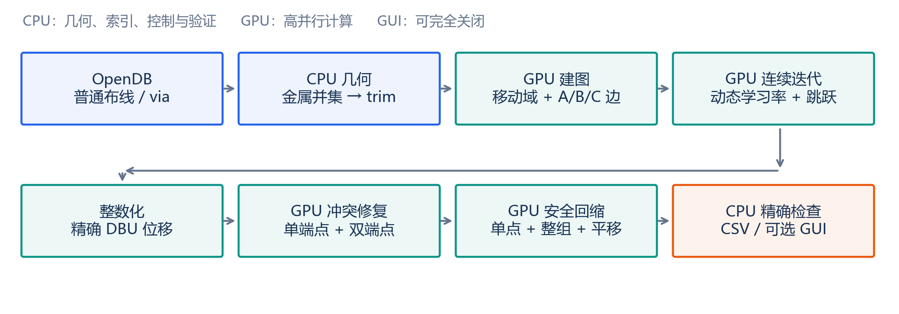

在当前 ASAP7 IBEX 样例中，处理规模为 **332,664 个 trim 节点、437,360 条约束边**。默认连续阶段结束时，残差 ≥5nm 的边为 64 条；完整 GPU 后处理后为 **36 条 ≥5nm、48 条严格小于 5nm 的正残差边**，合计 84 条。最终 trim 延长量为 **2607.572µm**。

当前结果是 **trim 模型与图形覆盖层的位移**，没有写回修改实际 dbWire。图约束残差不等同于完整工艺 DRC。本实现也不提供 LP/MIP 的全局最优证明。

本次汇报以当前代码和保存的实验记录为依据。所有示意图均为解释算法的绘图；GUI 图片是重新运行默认 150 轮后导出的 OpenROAD 真实视图。性能数据取关闭 GUI 的历史复测，截图运行不参与性能统计。

# 2. 形式化模型与评价指标

## 2.1 节点、坐标与移动域

每层建模为有向约束图，节点与 trim 一一对应。每个节点只沿该层首选布线方向移动；跨轨方向坐标保持固定。

$$G=(V,E),\qquad p_i=p_i^0+\delta_i,\qquad \delta_i\in[l_i,h_i].$$

| 符号 | 含义 |
| --- | --- |
| $W$ | 当前层基础线宽，单位 DBU |
| $p_i^0$、$t_i^0$ | 节点原始沿轨、跨轨中心位置 |
| $\delta_i$ | 沿轨方向位移；连续阶段可为小数，后处理为整数 DBU |
| $[l_i,h_i]$ | 障碍物和移动上限共同决定的硬移动域，包含零位移 |
| $R_e$ | 约束边允许的有向中心距离区间并集 |
| $b$ | 每微米 DBU 数；当前样例为 1000 |

为保留半 DBU 中心，几何数据使用双倍整数坐标：

$$P_i^0=2p_i^0,\qquad d_{ij}^{(2)}=P_j^0-P_i^0+2(\delta_j-\delta_i).$$

这里后处理取整的是位移，而不是原始中心。即使中心位于半 DBU，原始几何仍保持精确。

## 2.2 统一残差定义

对于边 $e=(i,j)$，距离为 $d_e=p_j-p_i$。若允许区间为若干个闭区间的并集，残差取距离该集合的最短距离：

$$R_e=\bigcup_m[L_{em},U_{em}].$$

$$r_e(d)=\min_m\max(0,L_{em}-d,d-U_{em}).$$

无穷界限在代码中使用 `has_low / has_high` 标志，不参与无意义的数值运算。残差为零表示满足当前图约束，正残差表示还需修复。

定义三个计数和延长量：

$$C_0=\sum_{e\in E}\mathbf{1}[r_e>0],\qquad C_5=\sum_{e\in E}\mathbf{1}[r_e\geq5\mathrm{nm}].$$

$$C_{<5}=\sum_{e\in E}\mathbf{1}[0<r_e<5\mathrm{nm}]=C_0-C_5,\qquad L=\sum_{i\in V}|\delta_i|.$$

**恰好 5nm 计入 $C_5$；残差为零不计入任何违例。** 连续阶段沿用 `1e-6 DBU` 的数值噪声过滤；整数阶段严格检查正残差，不加浮点容差。比较两个阶段的小残差数量时必须注明这个差别。

最终还报告最大残差、总残差、绝对位移总量与按高/低端方向计算的净延长量。当前样例移动域均朝外，因此绝对位移总量与净延长量相同；不能无条件推广到所有输入。

# 3. 输入几何与 trim 生成

## 3.1 从 OpenDB 读取什么

当前处理 M2–M7。逐层逐网络扫描普通 `dbWire`，提取矩形金属和 via 在该层的金属盒。供电网络的普通布线作为障碍物，不生成待优化 trim。所有普通网络金属，包括 trim 自己所属网络的金属，均可限制移动。

本实现保持 DEL 已验证的几何口径：不额外加入 special wire、pin 或 blockage。这里描述的是已实现模型的输入范围，而非完整工艺障碍物集合。

## 3.2 为什么先做矩形并集

同一网络、同一层的多个金属盒可能相交或相接。直接对每个矩形两端生成 trim，会把内部连接处或 jog 侧边误认为线端。因此先求金属矩形并集，再遍历外环及孔洞边界，结合原始首选方向端面确定真正暴露的末端。

trim 沿首选方向长 $W$，跨轨方向宽 $2W$，位于金属端面的外侧。对同几何及同端向的 trim 排序去重，再按沿轨位置等规则分配稳定的层内节点 ID。

```text
算法 1  生成 trim 节点（CPU）
输入：层内普通 dbWire 矩形及 via 金属盒
for each net on the current layer:
    obstacles += all metal boxes of the net
    if net is supply: continue
    union_geometry = RectangleUnion(metal_boxes)
    end_faces = OriginalPreferredDirectionEndFaces(metal_boxes)
    for each outer/hole boundary of union_geometry:
        exposed_faces = ClipBoundaryToEndFaces(boundary, end_faces)
        emit outward W-by-2W trims on exposed_faces
sort and deduplicate trims by geometry and end direction
assign deterministic node IDs and retain original centers in doubled DBU
```

矩形并集与端面识别当前仍在 CPU 执行；GPU 加速从移动域和连接边搜索开始。汇报建图加速时，必须把这部分 CPU 时间计入端到端建图耗时。

# 4. 移动域与金属阻挡查询

## 4.1 几何约束

移动域同时受到最大移动距离和最近阻挡金属限制，当前最大移动量为 $20W$。trim 与障碍物的边界接触允许，内部重叠不允许。

设当前 trim 的沿轨区间为 $[p_i^0-W/2,p_i^0+W/2]$。只考虑与 trim 跨轨带内部重叠的障碍物。左侧最近障碍的右边界记为 $B_i$，右侧最近障碍的左边界记为 $A_i$，则中心范围满足：

$$p_i^{\min}=\max(p_i^0-20W,\;B_i+W/2),\qquad p_i^{\max}=\min(p_i^0+20W,\;A_i-W/2).$$

不存在相应方向障碍时，只保留移动上限。若 trim 初态已与金属内部重叠，则节点标为 `blocked`，位移固定为零，不再尝试从重叠中移出。

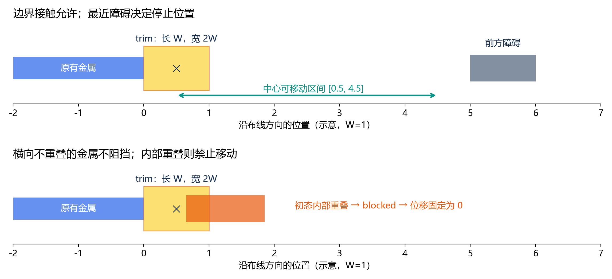

## 4.2 CPU 参考与 GPU 搜索

CPU 参考使用 R-tree 查询。GPU 路径由 CPU 先准备平衡 BVH 和双倍 DBU 障碍物盒，再由 GPU 为每个节点遍历 BVH，筛出移动扫掠范围内的候选金属，并执行相同的严格重叠及最近边界判断。

横向不重叠的金属会被排除；初态碰撞、边界接触、移动上限均使用整数比较。BVH 缩小候选集合，但并不改变几何判定规则。

```text
算法 2  移动域和约束边建图（CPU + GPU）
CPU: build balanced BVH for obstacle boxes
CPU: sort node indices by cross-track coordinate, then along-track coordinate
GPU parallel for each node i:
    query BVH inside the capped sweep box
    discard obstacles without strict cross-track overlap
    if any initial interior overlap: domain[i] = {0}; blocked[i] = true
    else tighten left/right travel by nearest obstacle boundaries
GPU pass 1: count potentially violating A/B/C neighbors for each node
GPU: exclusive prefix sum allocates compact arc output offsets
GPU pass 2: write arc endpoints and types into the allocated slots
CPU: reconstruct ranges; sort by type/src/dst; assign stable arc IDs
optional CPU reference build: compare every domain and arc exactly
```

# 5. A/B/C 约束图与稀疏数据结构

## 5.1 三类规则

边表示两个 trim 的规则关系，不是额外生成的真实金属线。当前规则参数为 $D=5W$、$D_t=5W$、$D_u=3W$。

| 类型 | 连接条件 | 允许的有向中心距离 |
| --- | --- | --- |
| A | 同轨、不是可面对面合并的端点对 | $[D,+\infty)$ |
| B | 同轨、左端为 high end 且右端为 low end | $\{0\}\cup[D_t,+\infty)$ |
| C | 跨轨距离非零且不超过一条 pitch 的节点对 | $(-\infty,-D_u]\cup\{0\}\cup[D_u,+\infty)$ |

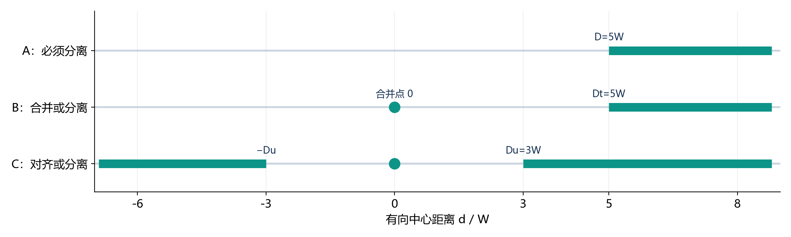

对节点对 $(i,j)$，所有可达到的有向距离构成：

$$I_{ij}=[p_j^{\min}-p_i^{\max},\;p_j^{\max}-p_i^{\min}].$$

若该区间整体包含于合法集合，则没有必要建边。否则，按同轨端向或邻轨关系生成对应约束。按最大移动量确定沿轨搜索窗口，利用轨道索引和二分查找减少候选，不构造全量节点对矩阵。

## 5.2 GPU 建边与迭代结构

建边采取“计数—前缀和—写入”两遍流程，按实际边数分配紧凑空间。主机统一排序使边 ID 不依赖 GPU 线程执行顺序。建图校验选项逐项比较 CPU/GPU 中心、移动域、blocked、类型、端点方向、边 ID 和合法区间。

优化阶段额外准备 CSR 邻接表和连通分量。CSR 让每个节点快速遍历关联边；独立分量没有公共节点或约束，适合分别调度跳跃及联合候选提交。

| 数据 | 用途 | 主要位置 |
| --- | --- | --- |
| 原始 Vnode、ArcRange | 精确几何、最终独立检查 | CPU 保留 |
| BVH、轨道排序索引 | 障碍物及邻域查询 | CPU 准备，GPU 查询 |
| 归一化节点/边、CSR | 连续势能与梯度 | GPU 常驻 |
| 连通分量边表 | 有序停滞修复、每分量候选选择 | GPU 常驻 |
| int64 精确位移与区间 | 整数修复、协同回缩 | 后处理 GPU 常驻 |

# 6. 连续迭代：梯度、学习率与停滞跳跃

## 6.1 归一化与势能

为在不同线宽层使用统一参数，位移和距离按层线宽归一化：

$$u_i=\delta_i/W,\qquad z_e=(p_j^0-p_i^0)/W+u_j-u_i.$$

连续阶段优化平滑模型：

$$F_k(u)=\lambda_k\sum_{e\in E}\phi_e(z_e)+\rho\sum_i\left(\sqrt{u_i^2+\epsilon^2}-\epsilon\right),\qquad \rho=\epsilon=0.01.$$

A 类采用分离不足的二次惩罚。B/C 类在合并点与分离合法区之间设置平滑势垒，基本函数为：

$$\psi(t)=16t^2(1-t)^2,\qquad 0\leq t\leq1.$$

| 类型/区间 | 实际规则势能 |
| --- | --- |
| A，全域 | $\min(0,z-D/W)^2$ |
| B，$z<0$ | $z^2$ |
| B，$0\leq z\leq D_t/W$ | $\psi(z/(D_t/W))$ |
| B，$z>D_t/W$ | 0 |
| C，$0<|z|<D_u/W$ | $\psi(|z|/(D_u/W))$ |
| C，其余位置 | 0 |

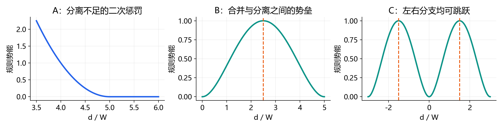

连续势能是搜索引导函数，不能直接替代精确残差或 ≥5nm 数量。任意用户自定义合法区间仍由 ArcRange 进行残差检查；连续势能保留当前 A/B/C 模型。

## 6.2 梯度方向与接受条件

节点梯度通过 CSR 累加关联边的有向导数，再按度数缩放并裁剪到移动域。核心方向为：

$$g_i=\rho\frac{u_i}{\sqrt{u_i^2+\epsilon^2}}+\lambda_k\sum_{e\ni i}\sigma_{ie}\phi'_e(z_e).$$

$$v_i=\operatorname{clip}\left(-g_i/(1+\deg(i)),\;l_i/W-u_i,\;h_i/W-u_i\right).$$

其中源端导数符号为负、目标端为正。设基础最大步长为 $s=0.25$，则全局方向缩放及单节点步长上限为：

$$a_k=\min\left(1,\frac{s}{\max_i|v_i|}\right),\qquad |\Delta u_i|\leq s\eta_k.$$

零方向时取 $a_k=1$。候选先按 $a_k\eta_k$ 缩放，按 $s\eta_k$ 限幅，再投影到硬移动域；只有全层势能严格下降才接受。初始候选失败后，最多尝试两种确定性小扰动。默认 `max_backtracks=0`，不再步长减半。

## 6.3 动态学习率与规则权重

规则惩罚权重每 25 轮提高一次，最高到 80；学习率是独立的位移比例：

$$\lambda_k=10\cdot2^{\min(3,\lfloor(k-1)/25\rfloor)}.$$

$$c_k=\eta_{\min}+\frac{\eta_{\mathrm{start}}-\eta_{\min}}{2}\left(1+\cos\frac{\pi(k-1)}{T-1}\right),\qquad \eta_k\leq\min(\eta_{k-1},c_k).$$

默认 $T=150$、起始比例 1.5、下限 0.5。每层单独维护控制器；单轮预算仅使用初值。反馈对下一轮生效：连续两轮普通梯度/扰动均未接受候选时乘 0.8；八轮窗口内未加权规则能量下降不足约 1%、且 ≥5nm 数量未减少时乘 0.85。比例不低于下限，只减不增。

反馈使用已有标量摘要，不增加完整坐标下载。成功跳跃不能被当作普通梯度接受，避免掩盖梯度停滞。

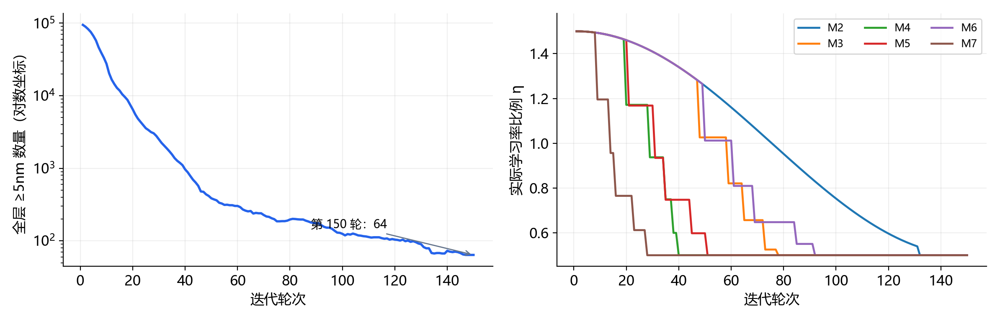

## 6.4 与 CPU 一致的停滞跳跃

若一条边在旧/新状态的残差均 ≥5nm，且两个端点取整到 DBU 后连续三轮没有可见移动，则检查 B/C 势垒。A 类以及负距离 B 不进行这类跳跃。

B 的中点为 $m=D_t/(2W)$；C 根据当前距离正负选取中点 $m=\pm D_u/(2W)$。目标距离位于另一侧：

$$z_{\mathrm{target}}=m\pm j,\qquad j=\frac{35b}{1000W}.$$

目标变化由两端按移动容量和节点度数分摊，不能超出任一硬域。每个 GPU 线程按原边顺序处理一个独立分量；成功后立即清零实际移动端点关联边的停滞计数。

**全层势能下降检查约束普通梯度候选；停滞跳跃可以提高势能以跨越势垒。** 因此不能声称连续阶段每一整轮的能量或违例数量必定单调下降。

```text
算法 3  连续 GPU 优化（每层）
u = zero displacement; initialize independent learning-rate controller
for k = 1 .. T, while strict conflict count is nonzero:
    lambda = 10 * 2^min(3, floor((k-1)/25))
    eta = AdaptiveRate(k, previous summaries)
    GPU: edge potentials/derivatives -> CSR gradients -> normalized direction
    try ordinary candidate, then at most two deterministic perturbations:
        clamp step by 0.25 * eta and project into hard movement domains
        accept only if whole-layer energy decreases sufficiently
    GPU: update stalled-edge counters using >=5nm and visible DBU movement
    GPU parallel over components:
        scan stalled edges in canonical order; apply feasible CPU-style jumps
        immediately reset counters incident to every moved endpoint
    reduce and read scalar statistics; update learning-rate feedback
    if GUI refresh is due: download current-layer snapshot and redraw
return last continuous state; do not restore a historical best snapshot
```

# 7. 整数化与精确检查口径

连续优化结束后，坐标仍留在 GPU。CPU 从原始图准备 int64 几何、整数位移域和确定性节点分组，上传后复用已有 CSR 与分量索引；不重建 trim 图。

整数位移硬域为：

$$l_i^I=\left\lceil\frac{\mathrm{low2}_i-P_i^0}{2}\right\rceil,\qquad h_i^I=\left\lfloor\frac{\mathrm{up2}_i-P_i^0}{2}\right\rfloor.$$

位移按最近整数取整后裁剪到域内，blocked 节点固定为零。负半整数的 ceil/floor 必须正确实现，不能用 C++ 默认的向零截断整除。

设整数双倍残差为 $r_e^{(2)}$，则：

$$r_e>0\iff r_e^{(2)}>0,\qquad r_e\geq5\mathrm{nm}\iff r_e^{(2)}\geq\left\lceil\frac{10b}{1000}\right\rceil.$$

这个写法避免直接将大残差乘以 1000。CPU 准备时同时检查几何及累计评分的整数溢出范围。

整数化并不保证优于连续解。当前样例的 ≥5nm 数量会暂时从 64 增至 99，因此把“连续末态、整数初态、修复后、回缩后”分开报告。后处理的单调改善保证从整数初态开始。

# 8. GPU 整数冲突修复

## 8.1 统一离散评分

整数修复采用字典序目标：

$$Q(\delta)=\left(C_5,\;C_0,\;\sum_e r_e^{(2)},\;\sum_i|\delta_i|\right).$$

前一项更重要，只有前项相同时才比较后一项；完全相等保持原位置。优先减少 ≥5nm 数量，再减少小违例和总残差，最后减少延长量。修复阶段允许局部规则变差，但整个候选必须使 $Q$ 严格改善；回缩阶段采用更强的逐边不变差条件。

## 8.2 分组单端点搜索

主机确定性着色，使同色节点之间没有直接约束；GPU 按颜色顺序执行，同色节点并行。每个活跃节点试探关联合法区间边界、域端点、零位移和附近 ±1/2/4/8 DBU 等少量候选。

每个候选检查该节点全部关联边，而不只检查当前冲突边。同色节点影响的边集合互不重叠，所以本组内接受的目标变化可以安全相加。不能把“没有共享节点”误当成任意双端点移动可同时提交。

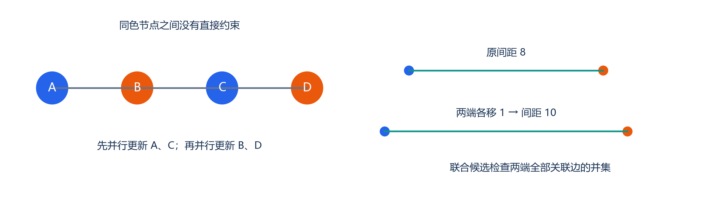

活跃集合从冲突端点及其邻域开始；移动后标记相关节点进入下一轮。当前/下一轮标记分离，避免清零覆盖新任务。阶段末统计全图，最终主机检查所有原始边。

## 8.3 双端点联合候选

单端点停滞后，为残余冲突试探其他合法区间、合并点及区间边界，联合分配两个端点的位移。评估两端关联边的并集，共同边只计一次。每条边并行产生候选，然后由每个独立分量的一个 block 选择该分量最优方案，每轮只提交一个。

这种策略既能跨越“任意单端点移动都不改善”的局部状态，也避免两组不共享端点、却由另一条边相连时发生并行评分失效。默认最多 24 次修复扫描，其中双端点最多 8 轮；无改善提前结束。

```text
算法 4  整数冲突修复（GPU）
x = rounded, domain-clamped integer displacements
active = violated endpoints and their neighborhood
for sweep = 1 .. 24:
    clear next_active and move counter
    for color in deterministic color order:
        parallel for active nodes of this color:
            candidates = interval boundaries, domain bounds, zero, nearby DBU
            evaluate all incident edges exactly
            commit the strictly best lexicographic improvement
            mark moved nodes and neighbors into next_active
    if any single-node move: swap active/next_active; continue
    if pair-round budget exhausted: break
    parallel for remaining violated edges:
        generate feasible joint endpoint candidates
        evaluate incident-edge union without double counting
    parallel for components: commit at most one best improving pair
    if no pair improved: break
    swap active/next_active
return repaired integer state and full-graph statistics
```

# 9. 安全回缩：单点、协同与整组平移

## 9.1 借鉴 DEL LP 的固定分支

原版 DEL 的 `polish()` 在每条边上选取距当前距离最近的合法区间，用当前残差向两侧扩展，使旧解可行，然后联合求解分量的延长量目标。GPU 回缩保留这个不加重现有残差的思路，不调用通用 LP/MIP。

对当前边距 $d_e$ 及残差 $g_e$，选定最近合法分支 $[L_e,U_e]$，得到安全区间：

$$\widetilde R_e=[L_e-g_e,U_e+g_e].$$

回缩方案必须满足硬移动域，并逐条满足新残差不超过当前残差，同时总延长量严格下降：

$$r_e(\delta')\leq r_e(\delta)\quad\forall e,\qquad L(\delta')<L(\delta).$$

该条件保证回缩不会增加 ≥5nm 数量、严格违例总数、最大残差或总残差。小于 5nm 的数量单独报告；在一般输入中，大违例下降到小违例可能改变这项分类，不能只用分类数量替代逐边检查。

## 9.2 单端点回缩

按颜色扫描每个节点，将各关联安全区间转成节点可行位置范围，求交后选择最靠近零位移的整数位置。逐边验证后提交。这个步骤简单、高效，但会停在端点互相锁住的位置。

## 9.3 协同回退量传播

令 $s_i=-\operatorname{sign}(\delta_i)$，用非负整数 $t_i$ 表示朝原始位置回退的距离：

$$\delta'_i=\delta_i+s_it_i,\qquad 0\leq t_i\leq|\delta_i|.$$

同向节点的约束可写成差分上界，例如 $t_i\leq t_j+\mathrm{slack}_{ij}$。相反方向节点共享有限间距余量，先确定性分配容量，再传播上界。两个回退量缓冲交替计算，坐标在此期间保持冻结。

最多传播 128 轮，每 8 轮读取一次变化标志。提交前再次精确检查所有边；若预算耗尽而某分量的共同回退仍不安全，则整个分量保留原位置，其余分量可提交。

## 9.4 合并组整体平移

仅允许每个节点朝零回退还不够：少数端点增加位移，也可能换来更多端点缩短。对相对位移无法变化的合并组，GPU 求整个组的平移范围，并优化绝对位移总量：

$$\tau^*=\operatorname{clip}\left(-\operatorname{median}_{i\in H}(\delta_i),\;\tau_{\min},\;\tau_{\max}\right).$$

因为所有组内节点加同一个 $\tau$，内部距离保持不变；组边界约束和每个节点移动域共同限制平移范围。每分量每轮只选择一个改善最大的组，逐边验证后提交。

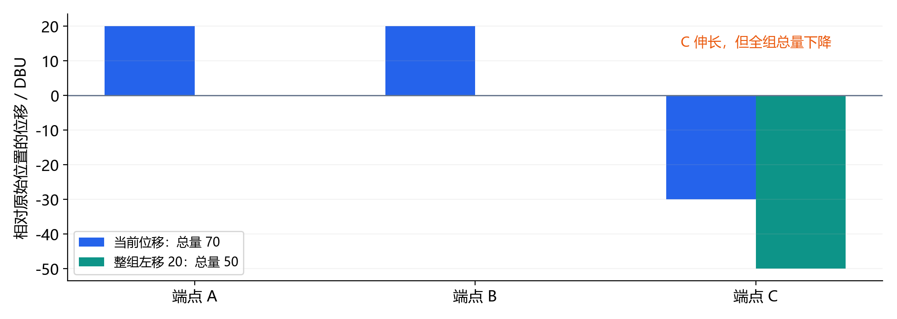

当前合并组平移只搜索不超过 256 个节点的组，以限制单线程候选工作的最坏成本；更大的组仍可参与单点及协同回退。它是有预算的局部优化，不等同于完整分量 LP 的全局最优。

```text
算法 5  安全回缩（GPU，默认最多 8 次扫描）
for sweep = 1 .. retract_budget:
    colored_single_moves = RetractEachNodeTowardZero()
    if colored_single_moves > 0: continue
    if mode == single: break
    freeze coordinates; choose nearest expanded interval on every edge
    initialize toward-zero capacities; propagate integer difference bounds
    verify all proposals; reject unsafe components; commit safe components
    recompute safe intervals on the updated snapshot
    GPU union-find: create equality-connected groups
    for each group with size <= 256:
        intersect node domains and boundary-edge safe intervals
        choose median-based shift; keep only strict total-length improvement
    select at most one group per component; verify every affected edge
    commit verified group shifts
    if neither collective method moved any node: break
return retracted integer state and full-graph statistics
```

模式默认为 `cooperative`；`single` 可复现旧回缩。16 次预算相对默认 8 次只多减少 0.047µm，因此保留 8 次作为效率优先选择。

# 10. GPU 数据流、GUI 开关与复杂度

## 10.1 主机与设备分工

DELGPU 逐层申请优化设备状态，层结束或异常时通过 RAII 释放。连续阶段复用一个非阻塞 stream，位移、试探位置、梯度、边势能、停滞标记和归约缓冲常驻 GPU；CUB 负责计数前缀和及统计归约。

每轮只下载小型统计摘要，主机据此调度学习率。图构建结束时仍需回传并排序边，整数后处理还会上传原始精确几何，因此“常驻设备”特指迭代/后处理内部，不表示整个输入输出没有传输。

## 10.2 GUI 必须与计算解耦

`-gui 0` 为默认值：不注册覆盖层，不保留显示图副本，也不下载中间完整坐标。最终独立检查仍需每层一次完整位移下载。当前全图为节点数乘以 8 字节，即 **2,661,312 字节**；标量摘要不包含在该计数内。

`-gui 1` 要求已启动 GUI。连续迭代按 `frame_ms` 节流，仅在实际刷新时下载当前层快照；`frame_ms=0` 只显示初态和末态。后处理结束后显示最终整数结果。开启显示的运行不能拿来比较 headless 性能。

覆盖层绘制 trim、节点、A/B/C 边和可选移动域；黄色表示 trim/节点，红/绿/青表示 A/B/C 类型。**红线不代表违例，绿色也不代表通过。** 判断违例以精确统计为准。

## 10.3 复杂度与主要限制

| 阶段 | 主要工作量及性能约束 |
| --- | --- |
| 几何准备 | 金属矩形并集和端面裁剪在 CPU；代价依赖几何复杂度 |
| 域/边搜索 | BVH 与轨道窗口压缩候选；与候选数和输出边数相关，极端密集情况下仍可能退化 |
| 连续普通迭代 | 每次候选约为节点、边及区间的线性扫描；默认最多三种尝试 |
| 连续停滞跳跃 | 分量之间并行；单个大分量仍有原顺序扫描的串行限制 |
| 整数局部搜索 | 候选数量与度数、合法区间数量相关；高阶节点比普通线性扫描更昂贵 |
| 协同回缩 | 传播最多 128 轮；组平移限制规模并按分量择一提交 |

这些限制说明加速来自减少不必要候选、设备常驻与安全并行，而不是把所有步骤都写成一个无限并行核。没有给出针对所有图的固定加速比保证。

# 11. 实验结果与性能口径

## 11.1 实验环境和测量方法

输入为 `flow/results/asap7/ibex/base/5_2_route.odb`，层为 M2–M7；设备为 RTX 5060 Laptop 8GiB，CUDA 12.9.1，Bazel/Clang CUDA 构建。固定 GUI 和建图重复校验关闭，预热后交替测量，每配置三次。图构建历史实验为各五次。质量三次一致，时间报告中位数。

保存的 `cooperative_1.csv` 用于绘制真实收敛和学习率曲线。各回缩方案逐层 `repaired` 行完全相同，因此是同一修复输入上的公平对照。不同研究阶段的数据表分别注明来源，没有把不同日期测得的时间相加或外推成整流程 CPU/GPU 加速比。

## 11.2 默认完整流程的质量变化

| 阶段 | ≥5nm | 0<残差<5nm | 全部正残差 | trim 延长量 µm |
| --- | ---: | ---: | ---: | ---: |
| 初始图 | 100,276 | 4,381 | 104,657 | 0 |
| 150 轮连续末态 | 64 | 80,129 | 80,193 | 2693.708982 |
| 取整后 | 99 | 5,070 | 5,169 | 2690.816000 |
| 整数冲突修复后 | 36 | 48 | 84 | 2754.178000 |
| 协同安全回缩后 | **36** | **48** | **84** | **2607.572000** |

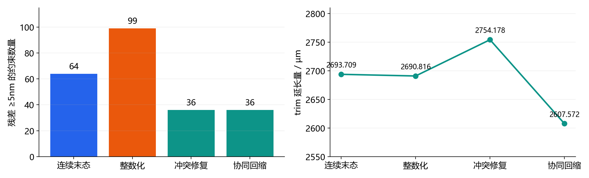

连续模型容易留下大量很小的正残差，取整会消除其中许多。因此不能把 80,129→48 的全部变化归因于整数搜索；从整数初态 5,070→48 才能清楚看出修复的独立作用。

相对连续末态，完整后处理减少 28 条 ≥5nm 违例（43.75%），延长量减少 86.136982µm（约 3.20%）。最大残差从 45nm 降至 16nm；取整后的残差总量为 7116nm，最终为 432nm。当前数据库中 DBU 与 nm 数值相同。

## 11.3 分层最终结果

| 层 | ≥5nm | 0<残差<5nm | 全部正残差 | 延长量 µm |
| --- | ---: | ---: | ---: | ---: |
| M2 | 32 | 48 | 80 | 1775.271 |
| M3 | 0 | 0 | 0 | 497.373 |
| M4 | 0 | 0 | 0 | 117.388 |
| M5 | 0 | 0 | 0 | 65.872 |
| M6 | 4 | 0 | 4 | 141.472 |
| M7 | 0 | 0 | 0 | 10.196 |
| 合计 | **36** | **48** | **84** | **2607.572** |

剩余冲突集中于 M2、M6；本结果不证明它们全部不可修复，只表示当前预算和局部候选下的最终状态。

## 11.4 回缩策略与运行时间

| 回缩方法 | 延长量 µm | 回缩 ms | 后处理总 ms | 优化总 ms |
| --- | ---: | ---: | ---: | ---: |
| 旧单点，8 次上限 | 2632.331 | 6.344 | 102.535 | 1938.550 |
| 协同，8 次上限（默认） | **2607.572** | **23.955** | **123.667** | **1967.562** |
| 协同，16 次上限 | 2607.525 | 28.708 | 128.474 | 2000.242 |
| 协同，32 次上限 | 2607.525 | 28.065 | 125.332 | 1992.438 |

四种配置的 ≥5nm / <5nm 结果均为 36 / 48。新版默认相对旧单点再减少 24.759µm（0.94%），回缩阶段增加约 17.6ms；16 次再节省 0.047µm，32 次无进一步收益。

默认协同 8 次的完整 delgpu 命令耗时中位数为 **2421.630ms**，额外包含建图，但不含命令外预先执行的读库。优化总耗时 **1967.562ms** 包含初始化、连续迭代、后处理、最终下载、统计输出和主机检查，排除建图。

`postprocess_ms` 包含主机精确几何准备、分组、上传、设备缓冲申请/释放、整数化、修复和回缩。CSV 的三个后处理阶段行统一在结果返回后写入，因此 `elapsed_ms` 不是这些阶段各自的结束时刻，阶段分析应看 `stage_ms`。

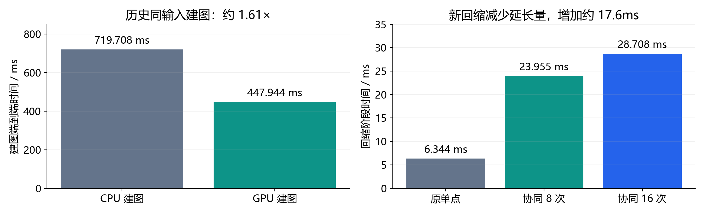

## 11.5 建图和学习率的历史对照

历史同输入建图验证中，CPU 建图中位数 719.708ms、GPU 为 447.944ms，约 1.61 倍加速；这个指标包含 CPU 几何、索引、传输和边排序，排除读库与 CUDA 初始化。

连续阶段的历史动态学习率实验中，固定学习率 200 轮得到 83 条 ≥5nm，优化中位数 2.654s；动态 150 轮得到 64 条，优化中位数 1.917s，约减少 27.8% 的时间。该实验显式关闭整数后处理，不能与当前完整后处理配置直接当作同方法的速度比较。

原版 CPU 的 200 轮加 LP/MIP 曾得到 36 条 ≥5nm，但连续输入和优化目标顺序不同。本报告不把这两个“36”解释为质量等价，也不据此计算 GPU 对原版 LP/MIP 的同输入加速比。

# 12. OpenROAD 真实 GUI 演示与复现

## 12.1 相同窗口的实际结果

下图为本次汇报重新导出的 M2 视图，窗口固定为 `[20.9,21.6] × [20.9,21.6]µm`。三个面板分别显示初始约束图、150 轮连续末态、150 轮加完整后处理后的末态。隐藏普通金属是为了清楚观察 trim 覆盖层。

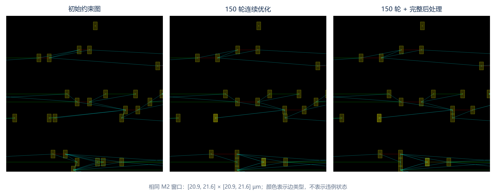

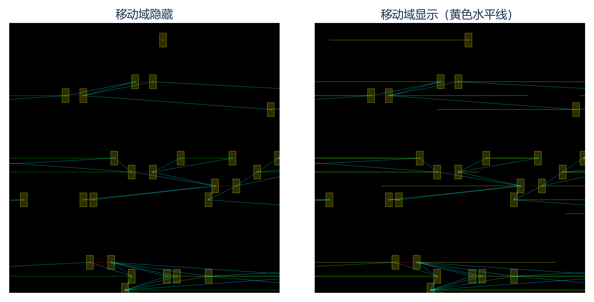

图中几何位置及连接端点确实随优化改变；边颜色始终表示类型。局部窗口内不能直接数出全设计的 36/48 条残差分类，具体数量以全图 CSV 和独立检查为准。GUI 坐标绘制采用整数像素/DBU 表示，精确几何检查仍保留双倍 DBU。

原始无拼接截图也一并保存，包括较大上下文窗口 `[20,24] × [20,24]µm`、局部窗口，以及 GUI 关闭后的图像。`data/gui_capture.log` 和两个 GUI CSV 记录真实参数，证明截图采用 150 轮而不是旧的 20 轮回归图片。

## 12.2 构建及命令

以下 shell 命令在 OpenROAD-flow-scripts 根目录执行；默认编译使用 `nproc` 返回的所有可用 CPU 线程，可显式覆盖。

```bash
./dev-openroad.sh build
./dev-openroad.sh build-delgpu
./dev-openroad.sh build -- --jobs=8
./dev-openroad.sh optimize --gui 0 --report /tmp/delgpu.csv
./dev-openroad.sh optimize --gui 1 --frame-ms 100
```

在已打开设计的 OpenROAD Tcl 控制台：

```tcl
delgpu -gui 1 -max_iterations 0 -verify 1
delgpu -gui 0
delgpu -gui 1 -frame_ms 0
delgpu -gui 0 -postprocess 0
delgpu -gui 0 -post_retract_mode single
delgpu -gui 0 -post_retract_sweeps 16
```

完整显式默认参数可写为：

```tcl
delgpu -gui 0 -max_iterations 150 -max_step 0.25 \
  -jump_offset_nm 35 -max_backtracks 0 \
  -learning_rate_mode adaptive -learning_rate 1.5 -learning_rate_end 0.5 \
  -postprocess 1 -post_sweeps 24 -post_pair_rounds 8 \
  -post_retract_mode cooperative -post_retract_sweeps 8 \
  -report /tmp/delgpu.csv
```

性能实验关闭 GUI 和重复 CPU 建图校验；首次 CUDA 初始化/JIT 与预热后测量分开。交替对照脚本为 `scripts/benchmark_retraction.tcl`，汇总脚本核对同一修复输入、三次质量一致、完整下载字节数以及两档残差计数恒等式。

# 13. 正确性保证、实现边界与后续工作

## 13.1 当前已经验证的性质

当前 CUDA 宿主与模块、CPU-only entry 构建通过，共 **76 个单元测试通过**。建图和连续优化测试覆盖随机/边界几何、CPU/GPU 参考迭代。

整数后处理测试覆盖半 DBU 中心、负半整数域、恰好 5nm、blocked 和无边图；还包括共享邻居、重复关联边、双端点局部极小值、传播截断及合并组平移。

```text
算法 6  最终独立整数检查（CPU）
for each original node i:
    require finite integer displacement delta[i]
    require original center2 + 2*delta[i] inside the original hard domain
    require delta[i] == 0 for blocked nodes
for each original ArcRange union:
    recompute exact doubled distance from original centers and displacements
    compute exact distance to the legal interval union
    accumulate positive, >=5nm, <5nm, max-gap and sum-gap statistics
require host statistics == GPU statistics, including extent and residual sums
```

后处理以整数初态为起点，接受的修复候选使字典序目标严格改善；回缩执行更强的逐边残差不增加和总延长量下降检查。分颜色、分量择一和冻结快照避免并行移动使评分失效。

GUI 真实截图及 offscreen 回归验证了最终图形更新、关闭 GUI 后覆盖层清理；headless 模式完整下载始终为 2,661,312 字节。实际普通布线长度保持 **89,786,472 DBU**，确认未写回修改 dbWire。

## 13.2 仍需明确的边界

| 项目 | 当前实现与限制 |
| --- | --- |
| 建图一致性 | 本样例逐项 CPU/GPU 精确一致；不意味着任意扩展工艺模型自动覆盖 |
| 迭代结果 | 追求速度与残差改善，不要求数值轨迹完全等于 CPU |
| 整数修复 | 局部候选搜索，不保证所有约束可满足或达到全局最优 |
| 安全回缩 | 固定当前分支，有传播和组大小预算，不等于通用 LP/MIP |
| 实际布线 | 当前输出为 trim 模型位移与覆盖层，不是已落库的新布线 |
| 工艺合法性 | 图约束指标不是完整 DRC，后续写回仍需完整验证 |
| 通用性能 | 当前主要在一个 IBEX 输入筛选和复测，需要更多设计验证 |

后续优先方向是分析 M2/M6 残余难分量、针对高阶节点优化局部候选评估、减少 CPU 几何和后处理分组准备开销，并扩展多设计实验。只有在相同连续输入下接入原 CPU LP/MIP 参考，才能给出可信的后处理质量及加速比对照。

# 附录 A. 代码、数据与图表来源

路径均相对 `tools/OpenROAD/src/delgpu/`，原版参考代码另注明。

| 汇报内容 | 主要源码/记录 |
| --- | --- |
| 命令、默认值、图生命周期 | `src/DelGpu.cpp`、`src/delgpu.tcl`、`include/delgpu/Parameters.h` |
| OpenDB 读取与 trim | `src/graph/BuildGraph.cpp`、`TrimGeometry.cpp`、`Vnodes.cpp` |
| CPU/GPU 域与边 | `Domains.cpp`、`Arcs.cpp`、`GraphGpu.cpp`、`GraphCuda.cu` |
| 规则和精确几何 | `include/delgpu/Rules.h`、`Graph.h` |
| 连续 GPU 优化 | `src/optimize/TrimOptimizer.cu`、`GpuAdapter.cpp` |
| 动态学习率 | `include/delgpu/AdaptiveLearningRate.h` |
| 整数化与独立检查 | `src/optimize/Postprocess.cpp` |
| 单/双端点与协同回缩核 | `src/optimize/Postprocess.cuh` |
| 统计、CSV 与 GUI 节流 | `src/optimize/RunOptimization.cpp`、`src/GraphGraphics.cpp` |
| CPU 后处理参考 | `../del/src/optimize/Postprocess.cpp` |
| 原始实测 | ORFS `flow/reports/asap7/ibex/base/delgpu_retraction/` |
| 历史分阶段验证 | `doc/graph_validation.md`、`adaptive_rate_validation.md`、`postprocess_validation.md`、`retraction_validation.md` |

报告目录包含 Markdown 原稿、PDF、离线 HTML、PNG/SVG 图表、真实 GUI 原图及冻结的 CSV/JSON。`data/source_manifest.json` 记录所用代码和数据的 SHA-256，便于后续版本更新时核对。源码与文档状态以后续修改为准，报告数字对应本次保存的证据快照。

# 附录 B. 汇报时可采用的讲述顺序

1. 用图 1 说明完整链路，指出 CPU/GPU 分工与可关闭的 GUI。
2. 用图 2、图 3 解释移动区域和 A/B/C 合法区间，统一残差定义。
3. 用图 4、图 5 说明动态梯度与跨势垒跳跃，区分规则权重和学习率。
4. 用图 6、图 7 解释整数修复及整组回缩，说明并行提交为什么安全。
5. 用图 8 和实验表展示 64→36、延长量 2693.709→2607.572 的结果。
6. 用图 10、图 11 展示真实 GUI，并以 36/48 违例、当前实现边界和后续工作结束。
