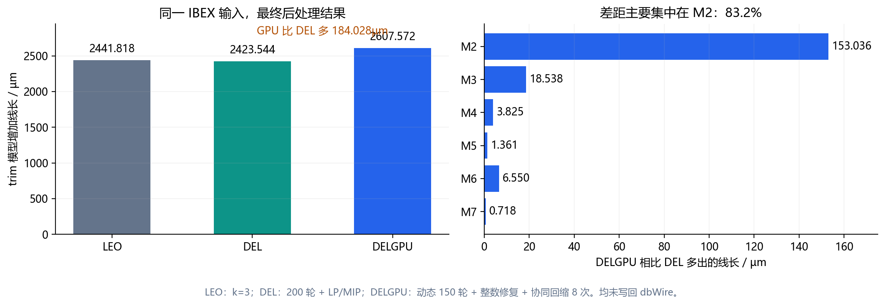

# LEO / DEL / DELGPU 增加线长对比

日期：2026-10-15。三种方法已在同一份 `flow/results/asap7/ibex/base/5_2_route.odb`
重新运行，GUI 关闭、DBU=1000、M2–M7。没有修改算法或重新调参。

## 统一比较口径

本文比较最终后处理完成后的 trim 模型增加量，采用各实现已有的
`extent_um = sum(abs(trim displacement))/DBU`。
LEO 和 DELGPU 同时输出的带方向净延长量在本输入上与它相等。
这不是只比较连续阶段，也不是已写回的实际新布线。

原始普通布线长度为 **89,786.472µm**。每个方法运行后都检查原 dbWire 长度未变化。
下表的增加比例分母为这份原始线长；后文“比另一方法多百分之几”的分母则为对方的增加量。

| 方法与配置 | 增加线长 µm | 占原始线长 | ≥5nm 违例 | 0<残差<5nm | 全部正残差 |
| --- | ---: | ---: | ---: | ---: | ---: |
| LEO：默认 k=3，LPA+EMA | 2441.818 | 2.7196% | 336 | 4 | 340 |
| DEL：200 轮，0.25W/35nm，LP/MIP | **2423.544** | **2.6992%** | **36** | **40** | **76** |
| DELGPU：动态 150 轮，整数修复，cooperative 8 次 | 2607.572 | 2.9042% | 36 | 48 | 84 |

“<5nm”严格表示正残差且小于 5nm，零残差不计入，恰好 5nm 计入 ≥5nm。
DEL 的数量来自最终 `_postprocess.csv` 和逐边 `_conflicts.csv`，不是第 200 轮连续末态；
DELGPU 来自 `final` 行，LEO 来自 EMA 后的最终行。三者最终分类均检查全部正残差。



本次与之前保存的三组最终质量结果一致：

- DELGPU 比 LEO 多 **165.754µm**，相对 LEO 增加量高 **6.7881%**。
- DELGPU 比 DEL 多 **184.028µm**，相对 DEL 增加量高 **7.5933%**。
- DEL 比 LEO 少 **18.274µm**，同时其 ≥5nm 和全部正残差违例均更少。

因此，DELGPU 的延长量确实偏高；不能把这部分额外长度全部解释为消除更多违例的必要代价。
DEL 在同为 36 条 ≥5nm 的情况下长度更短，且小违例少 8 条，说明当前 GPU 搜索仍有质量空间。
这里评价的是长度和残差两项，不能据此忽略原版 LP/MIP 较高的求解开销。

## 差距集中在哪些层

| 层 | LEO µm | DEL µm | DELGPU µm | GPU 比 LEO 多 | GPU 比 DEL 多 |
| --- | ---: | ---: | ---: | ---: | ---: |
| M2 | 1638.262 | 1622.235 | 1775.271 | 137.009 | **153.036** |
| M3 | 479.891 | 478.835 | 497.373 | 17.482 | 18.538 |
| M4 | 114.161 | 113.563 | 117.388 | 3.227 | 3.825 |
| M5 | 64.671 | 64.511 | 65.872 | 1.201 | 1.361 |
| M6 | 135.323 | 134.922 | 141.472 | 6.149 | 6.550 |
| M7 | 9.510 | 9.478 | 10.196 | 0.686 | 0.718 |
| 合计 | **2441.818** | **2423.544** | **2607.572** | **165.754** | **184.028** |

M2 占 GPU 相比 DEL 额外延长量的 **83.16%**；M2+M3 占 **93.23%**。
相对 LEO 的差距也主要集中于这两层。后续优化应优先分析 M2，而不是给所有层统一增加预算。

## 统一 20W 的额外控制实验

LEO 当前默认先计算完整障碍域，再按 `P=3*Dt=15W` 剪枝；DEL/DELGPU 保留 20W 上限。
因此默认三方法是同输入、各自公开配置的结果比较，并非所有中间搜索空间都完全相同。

额外执行 `leo -prune_factor 4`，将剪枝窗口统一到 20W：

| LEO 配置 | 节点数 | 保留弧数 | 增加线长 µm | ≥5nm | <5nm |
| --- | ---: | ---: | ---: | ---: | ---: |
| k=3，15W | 332664 | 372205 | 2441.818 | 336 | 4 |
| k=4，20W | 332664 | 437360 | 2441.843 | 335 | 5 |

20W 对照中，LEO 的节点和弧数量与 DEL/DELGPU 相同，延长量仅比默认变化 **0.025µm**。
DELGPU 相对这个 LEO 对照仍多 **165.729µm**，因此仅用 15W/20W 的窗口差异无法解释主要差距。
这里核对的是规模和结果，没有声称逐项核对了三方法内部全部状态。

## 从实现看，为什么还有额外长度

以下是源码支持的机制差异；本次没有通过消融实验把 184.028µm 逐项分摊为因果贡献。

1. **LEO 的 EMA 使用紧约束树整体移动。** 它可把通过零 slack 约束关联的一组端点一起移动，
   判断整棵树的带方向延长量是否下降，并保持已经接受的约束。当前 LEO 也仍有未接受约束，
   最终 340 条严格违例均被纳入统计，不能把短线长误解为已经全部合法。
2. **DEL 的整数 MIP 可以重选合法区间并联合优化整个分量。** 本次全部分量报告最优。
   当完全合法不可行时，依次最小化严格违例数、残差和延长量；完全合法的分量直接最小化延长量。
   它不仅压缩某一连续末态选中的固定分支。
3. **DELGPU 当前搜索受局部候选和安全回缩约束。** 修复主要是单/双端点，回缩是单点、
   朝原点协同回退及不超过 256 节点的合并组平移，尚未覆盖通用的混合端向紧约束树移动。
   回缩固定当前分支并要求每条边残差不增加，不能像 MIP 那样整体重选全部分支。
4. **仅增加回缩次数不能解决主要差距。** 已有同输入复测中，8 次为 2607.572µm，
   16/32 次为 2607.525µm，只再减少 **0.047µm**。主要限制更像候选与联合移动范围，
   而不是单纯扫描次数不足。

更有针对性的后续方向是：先对 M2 实现 LEO 式紧约束树压缩，覆盖非合并关系的整树移动；
再评估少量难分量的联合区间重选。应继续保持逐边残差检查，并把线长改善与额外耗时一起测量。
本次只做比较和分析，未修改 DELGPU 优化算法。

## 复现与保存的数据

```bash
# 在 ORFS 根目录执行。日志和计时 CSV 先写入 Linux /tmp。
mkdir -p /tmp/delgpu_three_methods_current
DELGPU_COMPARE_DIR=/tmp/delgpu_three_methods_current \
  ./dev-openroad.sh run -no_splash -exit \
  tools/OpenROAD/src/delgpu/scripts/compare_wire_extension.tcl \
  > /tmp/delgpu_three_methods_current/run.log 2>&1
python3 tools/OpenROAD/src/delgpu/scripts/summarize_three_methods.py \
  /tmp/delgpu_three_methods_current
```

脚本包含 LEO 默认与 20W 对照、DELGPU 默认配置、原版 DEL200+LP/MIP；
所有方法运行前后检查原普通布线长度。本次主比较与 20W 对照分别执行，
分别保存 `run.log.gz`、`leo20.log.gz`；复现脚本已将二者合并顺序执行。

保存目录：`flow/reports/asap7/ibex/base/delgpu_three_methods/`。
包含 `comparison.csv`、`layers.csv`、`comparison.json`、三方法原始质量 CSV、
DEL 最终逐层统计及逐边残差表、压缩日志及最终位移明细。
本次每种配置只重新运行一次以核对质量，记录的命令时间不作为重复性能基准或同输入后处理加速比。
